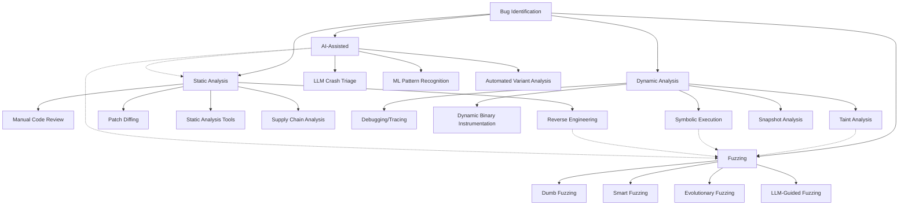

# SKILL: Bug Identification

## Metadata
- **Skill Name**: bug-identification
- **Folder**: offensive-bug-identification
- **Source**: https://github.com/SnailSploit/offensive-checklist/blob/main/bug-identification.md

## Description
Systematic bug identification methodology: source code review patterns, black-box testing strategies, taint analysis, dangerous function hunting, data flow tracing, and automated scanning setup. Use for code audits, bug bounty triage, or building vulnerability identification pipelines.

## Trigger Phrases
Use this skill when the conversation involves any of:
`bug identification, code review, taint analysis, dangerous functions, data flow, source audit, black box, vulnerability identification, static analysis, code audit, bug hunting`

## Instructions for Claude

When this skill is active:
1. Load and apply the full methodology below as your operational checklist
2. Follow steps in order unless the user specifies otherwise
3. For each technique, consider applicability to the current target/context
4. Track which checklist items have been completed
5. Suggest next steps based on findings

---

## Full Methodology

# Bug Identification

## Overview

Bug identification is the process of discovering potential vulnerabilities in software through various techniques including static analysis, dynamic analysis, and fuzzing. This document outlines methodologies and tools for effective vulnerability research.

For practical exploit development, see Exploit Development.

## Vulnerability Research Methodology

### Phase 1: Reconnaissance

- **Target Enumeration:** Identify version, dependencies, configuration
- **Attack Surface Mapping:** List all input vectors, APIs, protocols
- **Documentation Review:** RFCs, specifications, developer docs
- **Prior Art Analysis:** CVE database, exploit-db, bug trackers

### Phase 2: Static Analysis

- **Source Review:** If available, focus on parsing/validation code
- **Binary Analysis:** Reverse engineering with Ghidra/IDA
- **Patch Diffing:** Compare vulnerable vs patched versions
- **SBOM Analysis:** Check third-party component vulnerabilities

### Phase 3: Dynamic Analysis

- **Behavioral Analysis:** Monitor syscalls, network, file I/O
- **Debugging:** Trace execution paths with controlled input
- **Instrumentation:** Coverage-guided exploration
- **Taint Analysis:** Track input propagation

### Phase 4: Fuzzing

- **Corpus Generation:** Create valid seed inputs
- **Harness Development:** Isolate target functionality
- **Coverage Monitoring:** Identify untested code paths
- **Crash Triage:** Classify and prioritize findings

> 📎 Detailed content (full examples / references / data tables) has been split into `reference.md` in the same directory; use Read to load the relevant section on demand.

> 📎 **Reference Document Notice**: this skill is adapted from an upstream open-source repository; the following reference document is **not distributed with this library**: `development.md`. The key points of the related topics are retained in the corresponding descriptions in this document; if you need the expanded content, grep the library using keywords from the body text or search on your own.
