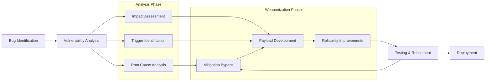

# SKILL: Exploit Development

## Metadata
- **Skill Name**: exploit-development
- **Folder**: offensive-exploit-development
- **Source**: https://github.com/SnailSploit/offensive-checklist/blob/main/development.md

## Description
Exploit development operational guide: environment setup, debugging workflow, PoC development lifecycle, writing reliable exploits, using pwntools/pwndbg, heap exploitation techniques, and weaponization considerations. Use when actively developing exploits or setting up an exploit dev environment.

## Trigger Phrases
Use this skill when the conversation involves any of:
`exploit development, pwntools, pwndbg, heap exploitation, PoC development, exploit reliability, weaponization, debugging workflow, exploit dev environment`

## Instructions for Claude

When this skill is active:
1. Load and apply the full methodology below as your operational checklist
2. Follow steps in order unless the user specifies otherwise
3. For each technique, consider applicability to the current target/context
4. Track which checklist items have been completed
5. Suggest next steps based on findings

---

## Full Methodology

# Exploit Development

## Exploit Development Process

- Checkout Bug Identification document for more information
- Also check Fuzzing for specific fuzzing topics
  - Integrate snapshot‑based fuzzing pipelines (AFL++, WinAFL, Snap‑Fuzz) and LLM‑guided input mutation to shorten time‑to‑bug.
  - Incorporate LLM‑assisted fuzzers (ChatAFL, HyLLFuzz) for grammar inference or plateau escape when grey‑box coverage stalls.
  - Add continuous‑integration security fuzzing (e.g., GitHub Actions with ASAN/UBSAN) so regressions are caught automatically.
- For Windows-specific vulnerabilities, see Windows Kernel

## Bug Types

### Stack Overflow

Involves memory on the stack getting corrupted due to improper bounds checking when a memory write operation takes place.

#### Case Study — CVE‑2025‑0910 (TinyFTP stack overflow)

- **Bug** – Unchecked `strcpy` copies user‐supplied file path into a 256‑byte stack buffer when handling `STOR` commands.
- **Trigger** – Send `STOR /` followed by 420 bytes of `A…` to overflow the buffer and clobber SEH frame.
- **Exploit** – Overwrite next SEH with a `pop pop ret` inside `msvcrt.dll`; pivot to payload that disables DEP via ROP then spawns a reverse shell.
- **Mitigations bypassed** – DEP (ROP), ASLR (module without /DYNAMICBASE), SEHOP disabled in default config.
- **Fixed in** v1.5.3 by replacing `strcpy` with `strncpy_s` and enabling `/DYNAMICBASE /GS`.

#### SEH

- structured exception handler is a linked list of all exception handlers ( try catch clauses) and the default windows exception handler as the last node.
- `ntdll!KiUserExceptionDispatcher` is responsible for the exception handling process which itself calls `RtlDispatchException`
- `RtlDispatchException` retrieves the `TEB` and parses the exception handling linked list using `NtTib->ExceptionList`
- [SafeSEH](https://learn.microsoft.com/en-us/cpp/build/reference/safeseh-image-has-safe-exception-handlers?view=msvc-170) mitigates handler over‑writes **only in 32‑bit images**. On x64 Windows, newer toolchains and components support Guard EH Continuations; adoption varies by binary and build. `SEHOP` remains enabled by default.
  - To check whether a module uses Guard EH Continuations, inspect `Load Configuration Directory → GuardEHContinuations` in the PE header (e.g., `dumpbin /loadconfig` or a `lief` script).
  - Many core system DLLs are compiled with EHCONT metadata plus `/GS`, `/CETCOMPAT`; the classic approach of choosing a module without SafeSEH or ASLR is increasingly rare. Verify per target.
- `RtlpExecuteHandlerForException` calls the `ntdll!ExecuteHandler2` which in turn calls the actual exception handler function after validation
- In a SEH buffer overflow we try to overflow the buffer and overwrite the `ExceptionList` starting at the buffer
- so that the dispatcher calls our handler pointer —we gain control of the instruction pointer **only if SEHOP is disabled or successfully bypassed**.
- you need to find a `pop-pop-ret` sequence to use in the exploit, you also need to identify and remove bad characters

#### EggHunting

- during exploit development you might be unable to find enough space for your payload at an static point, this is where you need egghunting
- you need a small search payload to scan virtual address space for a suitable payload location
- you can use [keystone engine](https://github.com/keystone-engine/keystone) to write your egghunter code
- On Windows 11+, classic egghunters still work, but **Control‑Flow Guard (CFG)** validates indirect jumps, so you need either a CFG exemption (e.g., a RWX region created with `VirtualProtect`) or a target module compiled without `/guard:cf`.

### Use After Free

The link to something isn't available anymore, so we just replace it with our binary and take over the program.

#### Case Study — CVE‑2024‑4852 (Edge WebView2 AudioRenderer UAF)

- **Bug** – `core::media::AudioRenderer` failed to remove a task from the render queue on stream abort, leaving a dangling pointer.
- **Trigger** – JavaScript `AudioContext` rapid open‑close loop × 1 000 on Windows 11 23H2.
- **Exploit** – Heap feng‑shui creates JSArray backing stores at freed slot; fake vtable gives arbitrary R/W, chained to `VirtualProtect` to run shellcode.
- **Mitigations bypassed** – CET shadow stack (JOP gadgets), XFG (indirect‑call target inside allowed GFID range).
- **Patched** in Edge 124.0.2365.18 with smart‑pointer ref‑count and `std::erase_if` queue purge.

#### Background

- C++ Smart Pointers
  - Intrusive: Microsoft chose this
  - Non-Intrusive
  - Linked
- when an object is created from a `C++` class and uses virtual functions
  - a `vptr` is created at compile time and points to a virtual function table `vtable/vftable`
  - the table holds pointer to virtual functions, when loaded into a register like `RAX`, a call is made to the appropriate offset for the desired virtual function
  - we count number of created instances, we decrement it when calling the release function
  - when the counter hits 0, destructor is called to delete the object, if there is still a reference to the deleted object we have a potential UAF
- Windows Heap Front‑End Allocators
  - **LFH (Low Fragmentation Heap)** – default on Windows 7–10 for user‑mode heaps
  - **Segment Heap** – default for Windows 10 2004+ and Windows 11 apps that opt in
  - Exploits often pivot by corrupting front‑end metadata before landing in the backend.
- For more advanced techniques, see Mitigations or Modern

> 📎 Detailed content (full examples / references / data tables) has been split into `reference.md` in the same directory; use Read to load the relevant section on demand.

> 📎 **Reference Document Notice**: this skill is adapted from an upstream open-source repository; the following reference documents are **not distributed with this library**: `bug-identification.md`, `fuzzing.md`, `mitigation.md`, `modern-mitigations.md`, `windows-kernel.md`. The key points of the related topics are retained in the corresponding descriptions in this document; if you need the expanded content, grep the library using keywords from the body text or search on your own.
