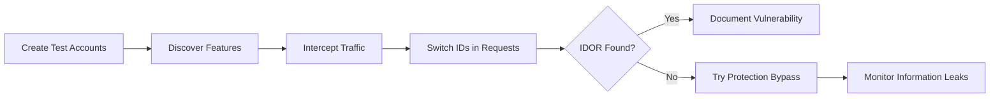
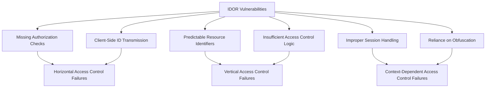

# SKILL: Insecure Direct Object References (IDOR)

## Metadata
- **Skill Name**: idor
- **Folder**: offensive-idor
- **Source**: https://github.com/SnailSploit/offensive-checklist/blob/main/idor.md

## Description
IDOR (Insecure Direct Object Reference) testing checklist: object ID enumeration, horizontal/vertical privilege escalation, GUID predictability, indirect references via hashes, chained IDOR, and API endpoint IDOR. Use for web app pentests and bug bounty IDOR discovery.

## Trigger Phrases
Use this skill when the conversation involves any of:
`IDOR, insecure direct object reference, horizontal privilege escalation, vertical privilege escalation, object enumeration, GUID, API IDOR, mass assignment, broken access control`

## Instructions for Claude

When this skill is active:
1. Load and apply the full methodology below as your operational checklist
2. Follow steps in order unless the user specifies otherwise
3. For each technique, consider applicability to the current target/context
4. Track which checklist items have been completed
5. Suggest next steps based on findings

---

## Full Methodology

# Insecure Direct Object References (IDOR)

## Shortcut

- Create two accounts for each application role and designate one as the attacker account and the other as the victim account.
- Discover features in the application that might lead to IDOR. Pay attention to features that return sensitive information or modify user data.
- Revisit the features you discovered in step 2. With a proxy, intercept your browser traffic while you browse through the sensitive functionalities.
- With a proxy, intercept each sensitive request and switch out the IDs that you see in the requests. If switching out IDs grants you access to other user's information or lets you change their data, this indicates an IDOR.
- Don't despair if the application seems to be immune to IDOR. Use this opportunity to try a protection bypass technique. If the application uses an encoded, hashed, or randomized ID, you can try decoding, or predicting the IDs. You can also try supplying the application with an ID when it does not ask for one. Finally, sometimes changing the request method type or file type makes all the difference.
- Monitor for information leaks in export files, email, and other text alerts. An IDOR now might lead to an information leak in the future.

## Mechanisms

Insecure Direct Object References (IDOR) occur when an application exposes a reference to an internal implementation object without sufficient access control. These vulnerabilities allow attackers to manipulate these references to access unauthorized data or perform unauthorized actions.

IDOR vulnerabilities arise from flawed access control mechanisms that fail to validate whether a user should have permission to access or modify a specific resource. The core implementation issues include:

- **Missing Authorization Checks**: No validation of user permissions when accessing objects
- **Client-Side ID Transmission**: Relying on client-provided identifiers without server-side verification
- **Predictable Resource Identifiers**: Sequential or easily guessable object references
- **Insufficient Access Control Logic**: Authentication without proper authorization
- **Improper Session Handling**: Not binding resources to user sessions
- **Reliance on Obfuscation**: Using complex identifiers without actual access control

IDORs manifest in various patterns:

- **Horizontal Access Control Failures**: Accessing resources belonging to other users of the same privilege level
- **Vertical Access Control Failures**: Accessing resources requiring higher privileges
- **Context-Dependent Access Control Failures**: Access based on improper contextual states

## Hunt

> 📎 详细内容（完整示例 / 参考 / 数据表）已拆分至同目录 `reference.md`，按需用 Read 读取对应小节。
