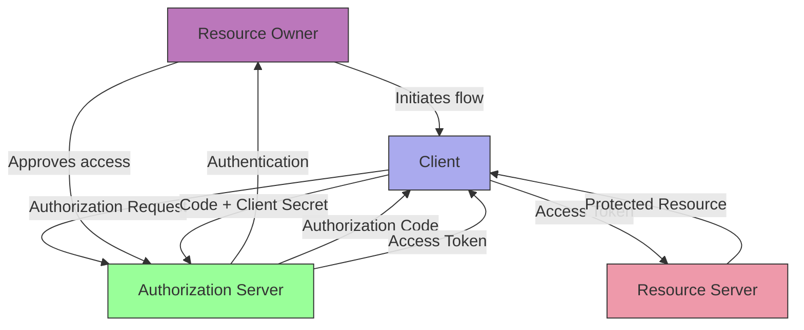

# SKILL: OAuth Security Testing

## Metadata
- **Skill Name**: oauth-attacks
- **Folder**: offensive-oauth
- **Source**: https://github.com/SnailSploit/offensive-checklist/blob/main/oauth.md

## Description
OAuth 2.0 attack checklist: authorization code interception, redirect_uri bypass, CSRF on OAuth flow, state parameter abuse, open redirector chaining, token leakage via Referer, PKCE bypass, and scope escalation. Use when testing OAuth implementations in web apps or bug bounty.

## Trigger Phrases
Use this skill when the conversation involves any of:
`OAuth, OAuth 2.0, authorization code, redirect_uri bypass, OAuth CSRF, state parameter, PKCE bypass, scope escalation, token leakage, open redirector, OAuth attack`

## Instructions for Claude

When this skill is active:
1. Load and apply the full methodology below as your operational checklist
2. Follow steps in order unless the user specifies otherwise
3. For each technique, consider applicability to the current target/context
4. Track which checklist items have been completed
5. Suggest next steps based on findings

---

## Full Methodology

# OAuth Security Testing

## Shortcut

- Check for improper redirect validation (open redirects)
- Test state parameter manipulation/absence
- Manipulate OAuth flows to bypass authentication
- Try URL path traversal in redirect_uri
- Hunt for client secret leakage in source code/repos
- Look for improper scope validation

## Mechanisms

- **OAuth 2.0** authorizes limited access to resources via tokens; pair with **OIDC** for identity.
- **Core Flows**:
  - Authorization Code (with PKCE for public clients)
  - Client Credentials (service-to-service)
  - Avoid Implicit and ROPC where possible
- **Key Components**:
  - Resource Owner (user)
  - Client (third-party app)
  - Authorization Server (issues tokens)
  - Resource Server (hosts protected resources)
  - Tokens (access and refresh)
- **Hardening Extensions**:
  - PAR (Pushed Authorization Requests), JAR (Request Objects), JARM (JWT-secured responses)
  - Sender‑constrained tokens (DPoP, mTLS)
  - `private_key_jwt` or mTLS client authentication for confidential clients

### OAuth/OIDC Considerations

- **PKCE everywhere**: Even with confidential clients/native apps; `code_verifier` must be required and validated.
- **Nonce/state binding**: For OIDC, ensure `nonce` is present and matched; `state` should be unguessable and tied to session.
- **`redirect_uri` exact match**: Enforce exact string match against pre-registered allowlist; no wildcards/path traversal.
- **`aud`/`azp`/`iss` enforcement**: Validate tokens strictly, including clock skew and JWKS `kid` rotation behavior.
- **Front-channel logout/login CSRF**: Validate logout CSRF; defend forced login to attacker accounts.
- **ID Token vs Access Token**: APIs must not accept ID tokens; check `token_type` and audience.
- **Device Code & CIBA**: Validate polling rate limits, code expiry, and binding of device/user codes.
- **Refresh Token Rotation**: Enforce reuse detection and global invalidation chains.
- **PAR/JAR/JARM**: Use to pin exact redirect_uri and inputs and to protect front-channel parameters.

### OAuth 2.1 Updates

- **Implicit Flow Deprecated**: Authorization servers should not support `response_type=token`
- **Password Grant Deprecated**: ROPC (Resource Owner Password Credentials) considered insecure
- **PKCE Mandatory**: Required for all OAuth clients including confidential clients
- **Exact Redirect URI Matching**: No more substring or prefix matching allowed
- **Refresh Token Sender Constraint**: Refresh tokens should be sender-constrained via DPoP or mTLS

### Financial-grade API (FAPI) Security

#### FAPI 1.0 Advanced Profile

- **Signed Request Objects (JAR)**: Authorization requests as signed JWTs
- **Hybrid Flow**: Uses `response_type=code id_token` for additional security
- **MTLS Client Authentication**: Certificate-bound tokens
- **JARM**: JWT-secured authorization response mode
- **Request Object Encryption**: Sensitive parameters encrypted

#### FAPI 2.0 Security Profile

- **Pushed Authorization Requests (PAR)**: POST request parameters to dedicated endpoint
- **DPoP (Demonstrating Proof-of-Possession)**: Token bound to client's key pair
- **Client Authentication**: `private_key_jwt` or MTLS required
- **Grant Management**: Rich authorization requests and grant management API

## Hunt

- Intercept OAuth flows with proxy (Burp/ZAP)
- Manipulate redirect_uri parameters
- Remove/tamper state parameter
- Test PKCE implementations
- Inspect token handling in browsers
- Check for client secret leakage
- Analyze scope handling logic
- Test account linking/unlinking
- Review token validation procedures
- Examine refresh token security

#### Native/Mobile

- Verify App Links/Universal Links to prevent hijacking callbacks.
- Ensure OAuth proxy components in mobile apps validate issuer and JWKS; do not ship client secrets in binaries.

#### SPA/Browser

- Use Authorization Code + PKCE; avoid Implicit/Hybrid unless justified.
- Store tokens in memory; if cookies are used, set `__Host-` prefix with `HttpOnly; Secure; SameSite`.

> 📎 详细内容（完整示例 / 参考 / 数据表）已拆分至同目录 `reference.md`，按需用 Read 读取对应小节。
