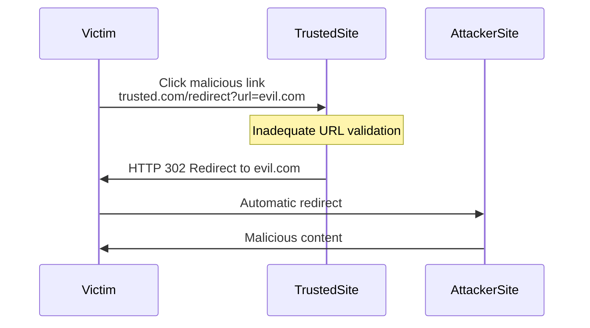

# SKILL: Open Redirect Vulnerabilities

## Metadata
- **Skill Name**: open-redirect
- **Folder**: offensive-open-redirect
- **Source**: https://github.com/SnailSploit/offensive-checklist/blob/main/open-redirect.md

## Description
Open redirect vulnerability checklist: parameter identification, bypass techniques (URL encoding, double slashes, CRLF injection, protocol handlers), chaining with OAuth/SSRF, and impact escalation paths. Use for web app testing and bug bounty open redirect discovery.

## Trigger Phrases
Use this skill when the conversation involves any of:
`open redirect, URL redirect, redirect bypass, URL encoding bypass, CRLF, protocol handler, redirect chain, OAuth redirect, SSRF chain, open redirection`

## Instructions for Claude

When this skill is active:
1. Load and apply the full methodology below as your operational checklist
2. Follow steps in order unless the user specifies otherwise
3. For each technique, consider applicability to the current target/context
4. Track which checklist items have been completed
5. Suggest next steps based on findings

---

## Full Methodology

# Open Redirect Vulnerabilities

## Shortcut

- Search for redirect URL parameters. These might be vulnerable to parameter based open redirect.
- Search for pages that perform referer based redirect. These are candidates for a referer based open redirect.
- Test the pages and parameters you've found for open redirect.
- If the server blocks the open redirect, try the protection bypass techniques mentioned before.
- Brainstorm ways of using the open redirect in your other bug chains.

## Mechanisms

Open redirect vulnerabilities occur when web applications improperly validate user-supplied URLs used for redirections. These vulnerabilities allow attackers to craft links that appear legitimate but redirect victims to malicious websites. When exploited, the victim initially connects to a trusted domain, giving the malicious link an appearance of legitimacy, before being redirected to an attacker-controlled destination.



The core technical flaws leading to open redirects include:

- **Insufficient URL Validation**: Failure to properly validate redirect targets
- **Improper Allowlist Implementation**: Flawed validation logic that can be bypassed
- **Inadequate Sanitization**: Incorrect handling of special characters or encoding
- **Trusting Client-Side Input**: Using user-supplied parameters for redirection without verification

### Notes

- Browsers restrict `javascript:` navigations from cross-origin contexts more, but many apps forward redirects to clients; validate server-side before emitting 3xx.
- OAuth/SSO stacks increasingly require exact `redirect_uri` match; test for partial/path-only allowlists and case/encoding mismatches.
- Mobile deep links: open redirects can escalate to app link hijack; test `intent:` URLs on Android and iOS universal link fallbacks.

### Modern Browser Behaviors

- **Chrome 120+ Restrictions**: Enhanced protection against cross-site redirects; test if app relies on specific redirect chains
- **SameSite Cookie Implications**: `SameSite=Lax` default affects redirect flows; test authentication state preservation
- **Referrer-Policy Impact**: `no-referrer` or `strict-origin` may break redirect detection; test logging/analytics dependencies
- **COOP/COEP Headers**: Cross-Origin-Opener-Policy can break popup-based OAuth flows
- **Fenced Frames**: New iframe replacement affects redirect chains in isolated contexts

Open redirects can exist in various implementation patterns:

- **URL Parameter Redirects**: Explicit redirect parameters (e.g., `?redirect=`, `?url=`, `?next=`)
- **Path-Based Redirects**: URL paths that trigger redirects (e.g., `/redirect/https://example.com`)
- **Referer-Based Redirects**: Redirects based on the HTTP Referer header
- **Post-Authentication Redirects**: Return URLs after login or authentication flows
- **URL Shorteners**: Services that redirect to expanded URLs
- **Framework Redirector Endpoints**: Dedicated redirection functionality in web frameworks

## Hunt

### Identifying Open Redirect Vulnerabilities

#### Target Discovery

1. **Identify Redirection Parameters**:
   - Common redirect parameter names:
     ```
     redirect, redirect_to, url, link, goto, return, returnTo, destination,
     next, checkout, checkout_url, continue, return_path, return_url,
     forward, path, redir, redirect_uri, view, img_url, image_url, load_url
     ```

2. **Find Redirection Endpoints**:
   - Social login integrations
   - Authentication flows
   - Payment gateways
   - "Share" functionality
   - URL shorteners
   - SSO implementations
   - File/resource access endpoints

3. **Search Code and Documentation**:
   - Review JavaScript for redirect functions
   - Check for framework-specific redirect endpoints
   - Analyze HTTP 3xx response patterns

#### Testing Methodologies

1. **Basic Open Redirect Testing**:
   - Test with absolute URLs:
     ```
     https://target.com/redirect?url=https://attacker.com
     https://target.com/redirect?next=https://attacker.com
     ```
   - Test with protocol-relative URLs:
     ```
     https://target.com/redirect?url=//attacker.com
     ```
   - Test with relative path traversal:
     ```
     https://target.com/redirect?url=/../redirect?url=https://attacker.com
     ```

2. **Referer-Based Open Redirect Testing**:
   - Identify pages that redirect based on Referer header
   - Modify Referer header to external domains
   - Test login/logout pages with custom Referer values

3. **OAuth Redirect Testing**:
   - Identify OAuth implementation redirect_uri parameters
   - Test for improper validation:
     ```
     https://target.com/oauth/authorize?client_id=CLIENT_ID&redirect_uri=https://attacker.com
     ```

> 📎 详细内容（完整示例 / 参考 / 数据表）已拆分至同目录 `reference.md`，按需用 Read 读取对应小节。
