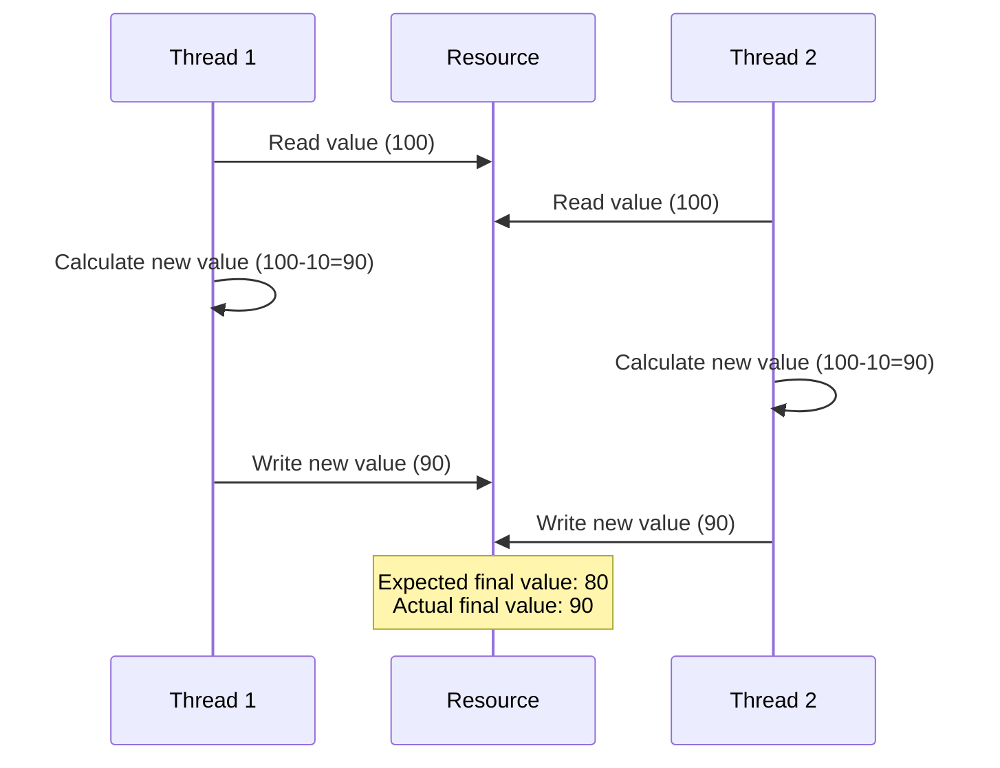
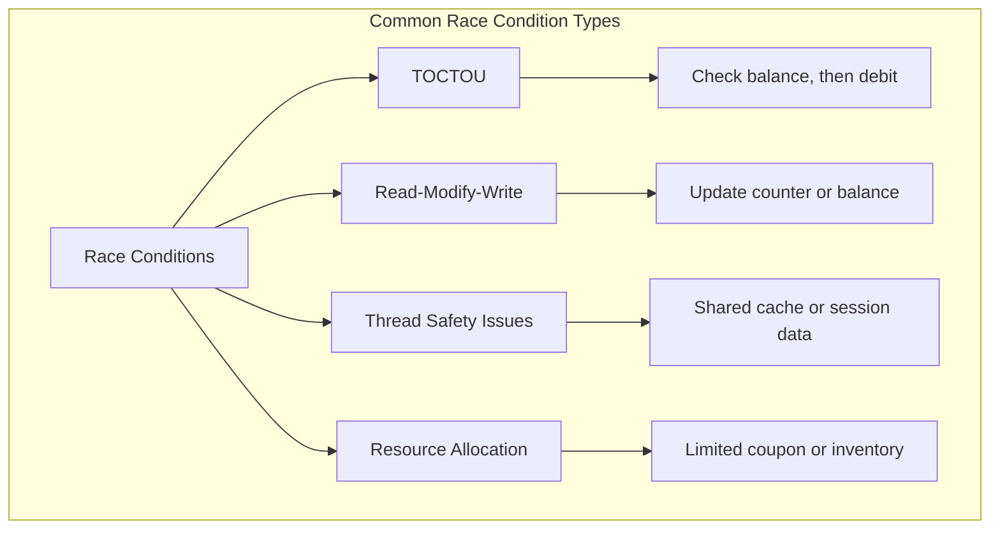

# SKILL: Race Conditions

## Metadata
- **Skill Name**: race-condition
- **Folder**: offensive-race-condition
- **Source**: https://github.com/SnailSploit/offensive-checklist/blob/main/race-condition.md

## Description
Race condition (TOCTOU) testing checklist: identifying timing windows, Burp Suite Turbo Intruder, Last-Byte sync technique, rate limit bypass, double-spend attacks, and concurrent request exploitation. Use for web app race condition testing or bug bounty time-of-check-to-time-of-use bugs.

## Trigger Phrases
Use this skill when the conversation involves any of:
`race condition, TOCTOU, timing attack, Turbo Intruder, last-byte sync, rate limit bypass, double spend, concurrent request, race window, time of check, time of use`

## Instructions for Claude

When this skill is active:
1. Load and apply the full methodology below as your operational checklist
2. Follow steps in order unless the user specifies otherwise
3. For each technique, consider applicability to the current target/context
4. Track which checklist items have been completed
5. Suggest next steps based on findings

---

## Full Methodology

# Race Conditions

## Shortcut

- Spot the features prone to race conditions in the target application and copy the corresponding requests.
- Send multiple of these critical requests to the server simultaneously. You should craft requests that should be allowed once but not allowed multiple times.
- Check the results to see if your attack has succeeded. And try to execute the attack multiple times to maximize the chance of success.
- Consider the impact of the race condition you just found.

## Mechanisms

Race conditions occur when the behavior of a system depends on the relative timing or sequence of events that can happen in different orders. In web application security, race conditions happen when multiple concurrent processes or threads access and manipulate the same resource simultaneously without proper synchronization.

A race condition becomes a security vulnerability when it affects security controls or business logic. The critical types include:

- Time-of-Check to Time-of-Use (TOCTOU): When a check is performed, but circumstances change before the result of the check is used
- Read-Modify-Write: When multiple processes read, modify, and write back a shared resource without coordination
- Thread Safety Issues: When multithreaded applications improperly handle shared resources
- Resource Allocation Races: Competition for limited resources like database connections or memory

Common vulnerable scenarios include:

- Account Balance Manipulation: Making multiple withdrawals/transfers simultaneously
- Coupon/Promotion Code Reuse: Using a single-use code multiple times
- File Upload Processing: Uploading and accessing temporary files before validation completes
- Registration Processes: Creating multiple accounts with the same unique identifier
- Token Verification: Using authentication tokens multiple times before they're invalidated

## Hunt

> 📎 详细内容（完整示例 / 参考 / 数据表）已拆分至同目录 `reference.md`，按需用 Read 读取对应小节。
