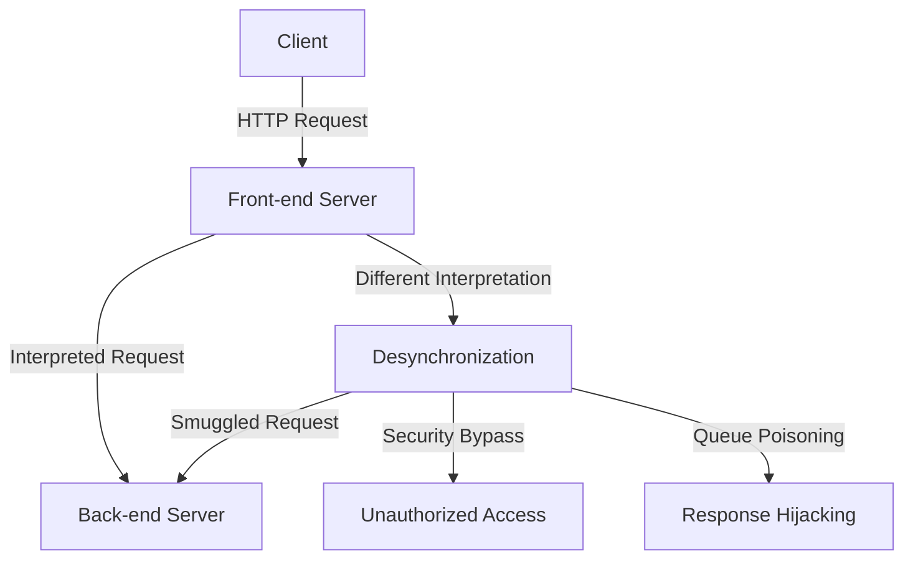
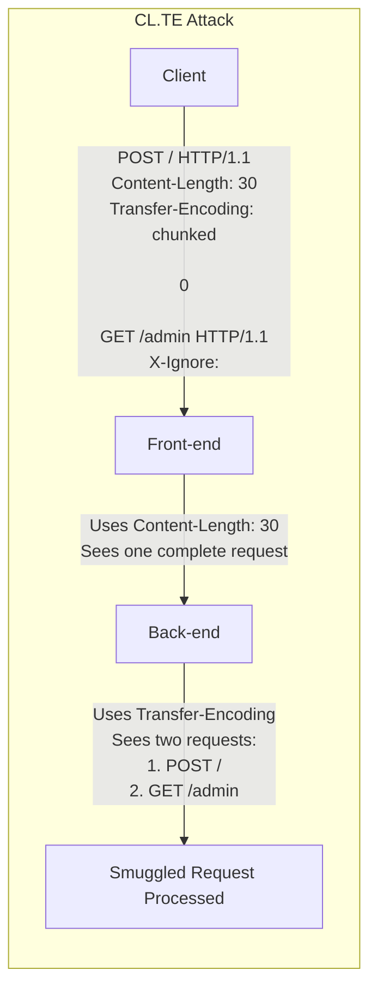

# SKILL: HTTP Request Smuggling

## Metadata
- **Skill Name**: request-smuggling
- **Folder**: offensive-request-smuggling
- **Source**: https://github.com/SnailSploit/offensive-checklist/blob/main/req-smuggle.md

## Description
HTTP request smuggling checklist: CL.TE, TE.CL, TE.TE variants, detection with timing and differential responses, WAF bypass, cache poisoning, credential hijacking, and request smuggling via HTTP/2. Use when testing reverse proxy/load balancer configurations.

## Trigger Phrases
Use this skill when the conversation involves any of:
`request smuggling, HTTP smuggling, CL.TE, TE.CL, TE.TE, HTTP/2 smuggling, cache poisoning, WAF bypass, differential response, smuggling detection, proxy desync`

## Instructions for Claude

When this skill is active:
1. Load and apply the full methodology below as your operational checklist
2. Follow steps in order unless the user specifies otherwise
3. For each technique, consider applicability to the current target/context
4. Track which checklist items have been completed
5. Suggest next steps based on findings

---

## Full Methodology

# HTTP Request Smuggling

## Mechanisms

HTTP Request Smuggling is a vulnerability that occurs when front-end and back-end servers interpret HTTP requests differently, leading to a desynchronization in the HTTP request processing chain. This desynchronization allows attackers to "smuggle" requests to the back-end server, potentially bypassing security controls or manipulating how other users' requests are processed.

Request smuggling vulnerabilities arise from inconsistencies in how servers parse and interpret HTTP messages, particularly regarding:

- **Transfer-Encoding (TE) header**: Indicates chunked encoding
- **Content-Length (CL) header**: Specifies the length of the message body
- **Header parsing**: Different handling of whitespace, newlines, and malformed headers

Common desynchronization scenarios include:

- **CL.TE**: Front-end uses Content-Length, back-end uses Transfer-Encoding
- **TE.CL**: Front-end uses Transfer-Encoding, back-end uses Content-Length
- **TE.TE**: Both servers use Transfer-Encoding but handle edge cases differently

HTTP/2/3 specific desync variants:

- H2.CL / H2.TE: Conflicts between HTTP/2 body length signaling and HTTP/1 backends during downgrade.
- H2C Upgrade: Cleartext HTTP/2 (h2c) upgrade paths mishandled by intermediaries.
- Authority/Host Confusion: `:authority` vs `Host` normalization inconsistencies under CDNs.

Modern variations include:

- **H2.HTTP/1**: HTTP/2 to HTTP/1 downgrades causing inconsistencies
- **HTTP/1.H2**: HTTP/1 to HTTP/2 transitions with different interpretations
- **Timeout-based**: Exploiting time differences in connection handling
- **Method-based**: Different interpretations of HTTP methods
- **Header-based**: Inconsistent header parsing between servers

## Hunt

> 📎 Detailed content (full examples / references / data tables) has been split into `reference.md` in the same directory; use Read to load the relevant section on demand.
