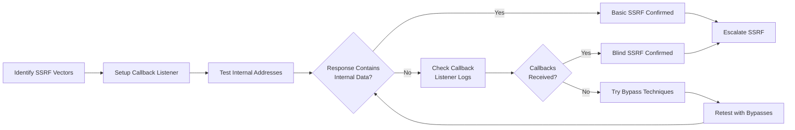
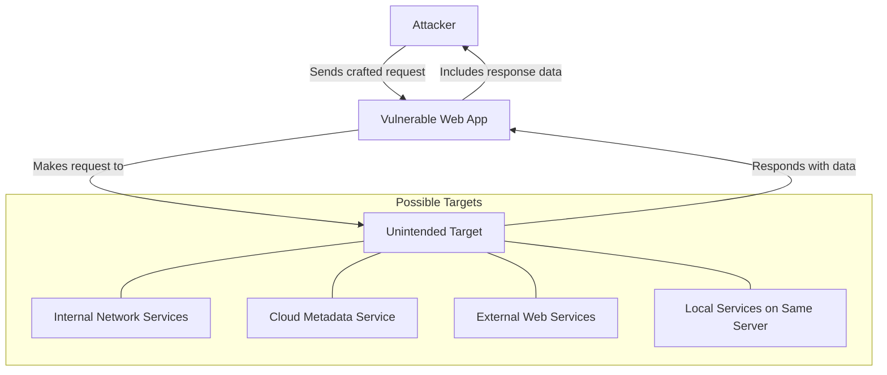

# SKILL: Server-Side Request Forgery (SSRF)

## Metadata
- **Skill Name**: ssrf
- **Folder**: offensive-ssrf
- **Source**: https://github.com/SnailSploit/offensive-checklist/blob/main/ssrf.md

## Description
Server-Side Request Forgery testing checklist: SSRF discovery, blind SSRF with out-of-band, cloud metadata endpoints (AWS/GCP/Azure), SSRF filter bypass techniques (IP encoding, DNS rebinding, redirect chains), and SSRF to RCE escalation. Use for web app SSRF testing and bug bounty.

## Trigger Phrases
Use this skill when the conversation involves any of:
`SSRF, server-side request forgery, blind SSRF, cloud metadata, AWS metadata, GCP metadata, SSRF bypass, DNS rebinding, redirect chain, SSRF RCE, internal port scan`

## Instructions for Claude

When this skill is active:
1. Load and apply the full methodology below as your operational checklist
2. Follow steps in order unless the user specifies otherwise
3. For each technique, consider applicability to the current target/context
4. Track which checklist items have been completed
5. Suggest next steps based on findings

---

## Full Methodology

# Server-Side Request Forgery (SSRF)

## Shortcut

- Spot the features prone to SSRF and take notes for future reference.
- Set up a callback listener to detect blind SSRF by using an online service, Netcat, or Burp's Collaborator feature.
- Provide the potentially vulnerable endpoints with common internal addresses or the address of your callback listener.
- Check if the server responds with information that confirms the SSRF. Or, in the case of a blind SSRF, check your server logs for requests from the target server.
- In the case of a blind SSRF, check if the server behavior differs when you request different hosts or ports.
- If SSRF protection is implemented, try to bypass it by using the strategies discussed in this chapter.
- Pick a tactic to escalate the SSRF.

## Mechanisms

Server-Side Request Forgery (SSRF) is a vulnerability that allows attackers to induce a server-side application to make requests to an unintended location. In a successful SSRF attack, the attacker can force the server to connect to:

- Internal services within the organization's infrastructure
- External systems on the internet
- Services on the same server (localhost)
- Cloud service provider metadata endpoints

Types of SSRF include:

- **Basic SSRF**: Direct requests to internal/external resources
- **Blind SSRF**: No response returned, but requests still occur
- **Semi-blind SSRF**: Limited information returned in responses
- **Time-based SSRF**: Detection through response timing differences
- **Out-of-band SSRF**: Secondary channel used for data exfiltration

## Hunt

> 📎 详细内容（完整示例 / 参考 / 数据表）已拆分至同目录 `reference.md`，按需用 Read 读取对应小节。
