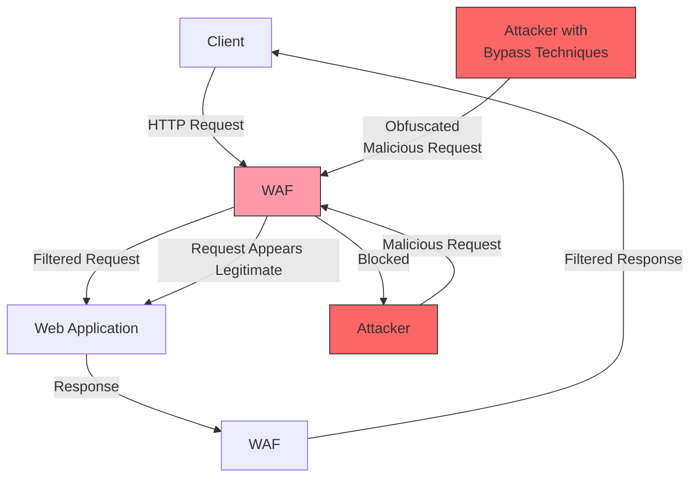
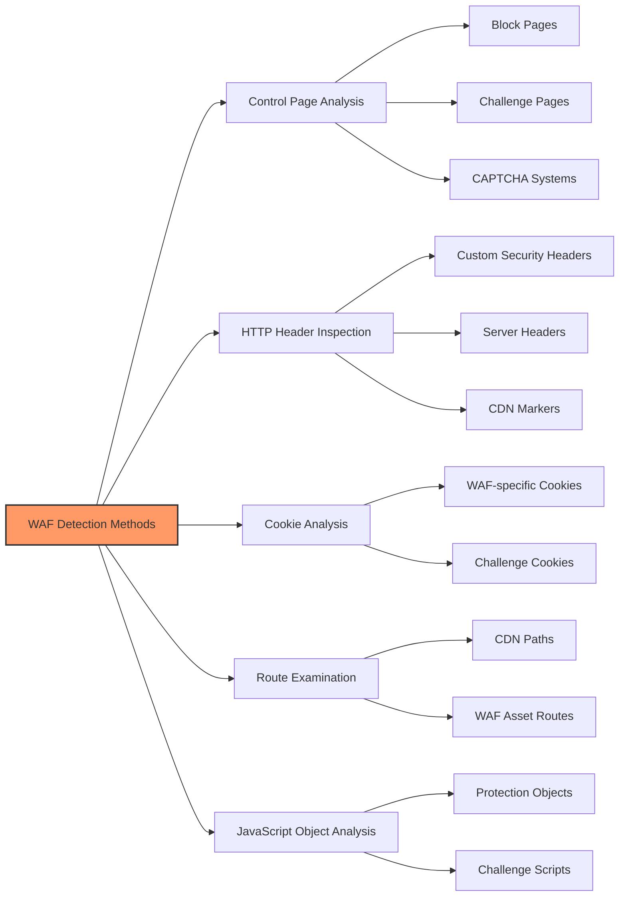

# SKILL: WAF Bypass Techniques

## Metadata
- **Skill Name**: waf-bypass
- **Folder**: offensive-waf-bypass
- **Source**: https://github.com/SnailSploit/offensive-checklist/blob/main/waf-bypass.md

## Description
WAF bypass techniques checklist: encoding bypass (URL/HTML/Unicode/double encoding), case variation, comment injection, HTTP header manipulation, chunked encoding, IP rotation, timing attacks, and payload obfuscation per WAF vendor. Use when WAF is blocking payloads during web app tests.

## Trigger Phrases
Use this skill when the conversation involves any of:
`WAF bypass, web application firewall bypass, URL encoding, double encoding, Unicode bypass, comment injection, HTTP header bypass, chunked encoding, IP rotation, payload obfuscation, WAF evasion`

## Instructions for Claude

When this skill is active:
1. Load and apply the full methodology below as your operational checklist
2. Follow steps in order unless the user specifies otherwise
3. For each technique, consider applicability to the current target/context
4. Track which checklist items have been completed
5. Suggest next steps based on findings

---

## Full Methodology

# WAF Bypass Techniques

A Web Application Firewall (WAF) is a security tool that protects web applications from various attacks by analyzing HTTP requests and applying rules to identify and block suspicious traffic. This document outlines effective techniques to bypass WAF protections during security assessments.

## WAF Overview

WAFs operate in two primary models:

- **Negative Model (Blacklist-based)**: Uses pre-set signatures to block known malicious requests, effective against common vulnerabilities
- **Positive Model (Whitelist-based)**: Only allows requests that match specific patterns, blocking everything else by default

## Popular WAFs

- **Cloudflare** - Identified by `__cf_bm`, `cf_clearance`, `cf_chl_*` cookies and "/cdn-cgi/" routes (cookies rotate roughly every 30 min)
- **Akamai**
- **Imperva/Incapsula** - Look for "X-CDN: Incapsula" headers
- **AWS WAF** - Commonly sets `AWSALB` or `AWSALBCORS` cookies
- **Sucuri** - Check for "X-Sucuri-ID" headers
- **DataDome**
- **F5 Networks**
- **Barracuda**
- **Fortinet**
- **ModSecurity** - Open-source WAF, commonly used with Apache
- **NAXSI** - Open-source WAF for NGINX
- **Azure Front Door**
- **Fastly Next-Gen WAF**
- **Cloudflare AI WAF**
- **Radware**
- **Coraza** - Modern open‑source WAF written in Go

## Detection Methods

1. **Inspect Control Pages** - Many WAFs display specific pages when blocking access
2. **Analyze HTTP Headers** - Check response headers for WAF-specific indicators
3. **Examine Cookies** - WAFs often set specific cookies (e.g., cf_clearance for Cloudflare)
4. **Look for Specific Routes** - e.g., /cdn-cgi/ for Cloudflare
5. **Check JavaScript Objects** - WAFs inject specific JS objects (e.g., `\_cf_chl_opt`)
6. **JA3/JA4/TLS Fingerprints** - Compare your client’s TLS fingerprint with common browser fingerprints; mismatches are often blocked.
7. **HTTP/2/3 Support** - Identify protocol negotiation; some WAF policies differ by protocol.

### Fingerprinting WAFs

Some specific fingerprints of common WAFs:

- **Apache Generic**: Writing method type in lowercase (e.g., `get` instead of `GET`)
- **IIS Generic**: Using tabs before method (e.g., `    GET /login.php HTTP/1.1`)
- **Cloudflare**: Challenge pages with JavaScript verification
- **ModSecurity**: Specific error messages and block pages
- **AWS WAF**: AWSELB cookies and specific headers
- **Fastly Next‑Gen WAF**: `fastly-debug-*` headers (when enabled), service IDs in responses
- **Cloudflare Bot Fight Mode/AI WAF**: presence of Turnstile, managed challenge flows, Bot Management headers

## Bypass Techniques

### 1. Use Residential IPs

- **Data center IPs** are easily detected by WAFs
- **Residential IPs** appear legitimate as they come from ISPs
- **Mobile IPs** are useful for websites showing different content for mobile users
- Use proxy rotation services to avoid IP-based rate limiting

### 2. Fortify Headless Browsers

Headless browsers often set special headers or variables that help WAFs recognize them as automation tools. Use the following libraries to make headless browsers appear more human-like:

- `undetected_chromedriver` for Selenium
- `puppeteer-extra-plugin-stealth` for Puppeteer/Playwright
- `playwright-extra` with `playwright-extra-plugin-stealth` for Playwright

> 📎 详细内容（完整示例 / 参考 / 数据表）已拆分至同目录 `reference.md`，按需用 Read 读取对应小节。
