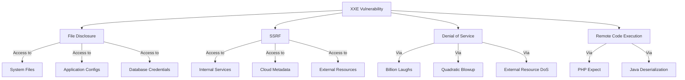
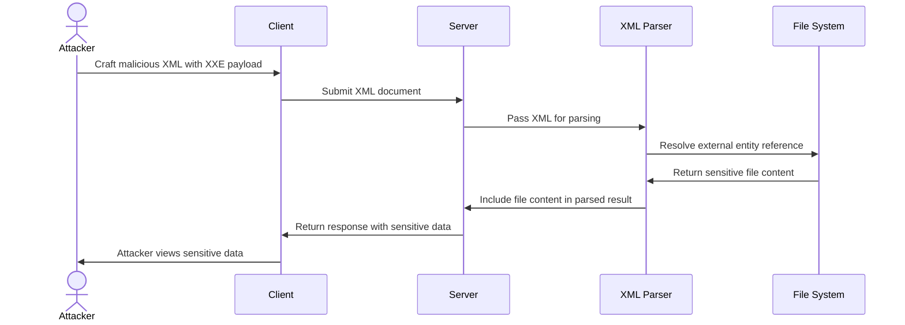
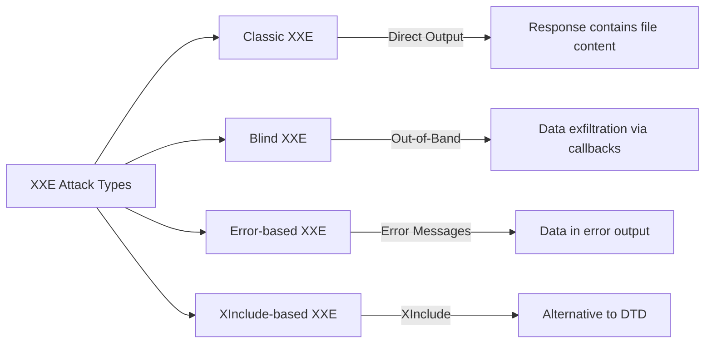

# SKILL: XML External Entity (XXE) Injection

## Metadata
- **Skill Name**: xxe
- **Folder**: offensive-xxe
- **Source**: https://github.com/SnailSploit/offensive-checklist/blob/main/xxe.md

## Description
XML External Entity injection testing checklist: classic XXE, blind XXE (out-of-band), XXE via file upload (SVG/docx), XXE in SOAP/REST, error-based XXE, XInclude attacks, and XXE filter bypass. Use for web app XXE testing and bug bounty.

## Trigger Phrases
Use this skill when the conversation involves any of:
`XXE, XML external entity, blind XXE, out-of-band XXE, XXE file upload, SVG XXE, SOAP XXE, XInclude, entity bypass, XXE SSRF, XXE file read`

## Instructions for Claude

When this skill is active:
1. Load and apply the full methodology below as your operational checklist
2. Follow steps in order unless the user specifies otherwise
3. For each technique, consider applicability to the current target/context
4. Track which checklist items have been completed
5. Suggest next steps based on findings

---

## Full Methodology

# XML External Entity (XXE) Injection

## Shortcut

- Find data entry points that you can use to submit XML data.
- Determine whether the entry point is a candidate for a classic or blind XXE. The endpoint might be vulnerable to classic XXE if it returns the parsed XML data in the HTTP response. If the endpoint does not return results, it might still be vulnerable to blind XXE, and you should set up a callback listener for your tests.
- Try out a few test payloads to see if the parser is improperly configured. In the case of classic XXE, you can check whether the parser is processing external entities. In the case of blind XXE, you can make the server send requests to your callback listener to see if you can trigger outbound interaction.
- Try to exfiltrate a common system file, like /etc/hostname.
- You can also try to retrieve some more sensitive system files, like /etc/shadow or ~/.bash_history.
- If you cannot exfiltrate the entire file with a simple XXE payload, try to use an alternative data exfiltration method.
- See if you can launch an SSRF attack using the XXE.

## Mechanisms

XML External Entity (XXE) is a vulnerability that occurs when XML parsers process external entity references within XML documents. XXE attacks target applications that parse XML input and can lead to:

- Disclosure of confidential files and data
- Server-side request forgery (SSRF)
- Denial of service attacks
- Remote code execution in some cases

XXE vulnerabilities arise from XML's Document Type Definition (DTD) feature, which allows defining entities that can reference external resources. When a vulnerable XML parser processes these entities, it retrieves and includes the external resources, potentially exposing sensitive information.

In practice, full remote code execution rarely stems from XXE alone; it typically requires language-specific gadgets—such as PHP's `expect://` wrapper or Java deserialization sinks—which XXE merely helps reach.

Types of XXE attacks include:

- **Classic XXE**: Direct extraction of data visible in responses
- **Blind XXE**: No direct output, but data can be exfiltrated through out-of-band techniques
- **Error-based XXE**: Leveraging error messages to extract data
- **XInclude-based XXE**: Using XInclude when direct DTD access is restricted

## Hunt

> 📎 Detailed content (full examples / references / data tables) has been split into `reference.md` in the same directory; use Read to load the relevant section on demand.
