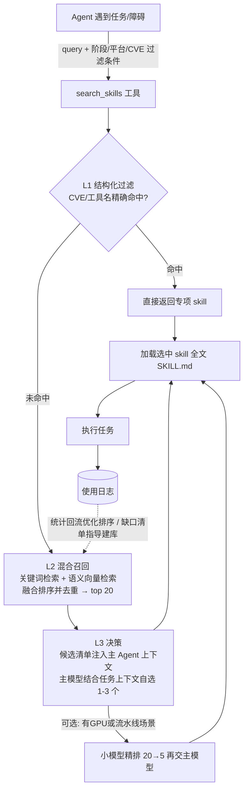

# 万级安全 Skill 库自动选用 · 最终方案说明

> 本文是 [SKILL-PLAN.md](SKILL-PLAN.md) 的浓缩版：只讲最终方法的思路、流程和关键说明，不涉及数据库 DDL、索引代码、提示词模板等实现细节。

---

## 1. 背景与目标

- **现状**：仓库已有 ~1000 个攻击侧 SKILL.md（规划扩展到 1 万个），覆盖侦察、利用、提权、横向等 50 个攻击大类；已有一份静态路由表和一套 skill 入库 MySQL 的同步脚本。
- **目标**：Agent 在执行漏洞挖掘/利用任务时，能**自主判断该用哪个 skill**，并在合适的时机加载它。
- **硬约束**：不能大幅提升 token 开销（单次路由控制在几百 token）和时间开销（亚秒级），不依赖昂贵的人工维护。

## 2. 为什么两种直觉方案不够

| 方案 | 一句话概括 | 核心问题 |
| --- | --- | --- |
| 小模型判断相关度 | 用一个小模型给 (任务, skill) 打相关分 | 对 1 万个候选逐一打分成本爆炸；小模型缺召回层无法独立成方案；需 GPU 部署；安全黑话区分度差；决策黑盒不可审计 |
| 静态路由表（Router） | 预编「触发词 → 推荐 skill」映射表，Agent 查表 | 1000 skill 的表已 7k token，外推到 1 万会撑爆上下文；每次增删 skill 都要人工维护路由表；任务换个说法就路由失败 |

**结论**：两者不是二选一，而是互补——用 Router 的骨架（分层、规则纪律、可审计），嵌入检索模型的部件（语义召回、精排），构成下述混合方案。

## 3. 最终方法：三层漏斗式混合路由

核心思想一句话：**先把 1 万压到 20（廉价检索），再由主模型从 20 挑 1-3（免费精排），选中后才加载全文（按需付费）**。

### 3.1 流程图



纯文本版：

```
任务上下文
   │
   ▼
L1 结构化过滤 ──CVE/工具名精确命中──▶ 直接返回（短路）
   │ 按攻击阶段/平台缩小范围：1万 → 数百
   ▼
L2 混合召回 ──关键词 + 语义向量双路检索，融合去重──▶ top 20
   │ （零 LLM 调用，毫秒级）
   ▼
L3 决策 ──候选描述（~600 token）交给主 Agent，自选 1-3 个──▶
   │ （可选：小模型先精排到 top 5）
   ▼
加载选中 skill 全文 → 执行 → 写使用日志 → 回流优化排序
```

### 3.2 三层各做什么（不含实现细节）

| 层 | 职责 | 成本 |
| --- | --- | --- |
| **L1 结构化过滤** | 利用每个 skill 预先标注的元数据（攻击阶段、目标平台、CVE、工具名）做硬性筛选；CVE 或工具名精确命中时直接短路返回 | 0 token，毫秒级 |
| **L2 混合召回** | 双路检索互补：关键词检索抓精确术语（CVE 号、工具名、gadget 名），语义向量抓换说法（"让服务器替我发请求"= SSRF）；融合后按主题去重，输出 top 20 | 0 LLM token，<50ms |
| **L3 决策** | 把 20 条候选的名称+描述（每条一行）返回给主 Agent，由主模型结合完整任务上下文挑选 1-3 个。主模型本身就是最强且免费的精排器 | ~600 token |

Agent 侧只感知**一个工具**：`search_skills(query, 阶段, 平台, CVE)`，返回带分数和命中原因的候选清单；选中后再用现有 Skill 加载机制读全文。

### 3.3 三个关键设计说明

1. **渐进式披露（token 控制的核心）**
   信息按四层逐级展开，每层只为上一层的选中者付费：
   `工具说明（~200 token 常驻）→ 候选描述（每次 ~600）→ 选中 skill 全文（1-2k/个）→ 附属参考资料（按需）`。
   相比现有 7k token 常驻路由表，全程路由 8 次也只花约 5k token，反而更省。

2. **主模型决策优先，小模型只做可选精排**
   默认不加任何模型组件——候选清单直接交给主 Agent 挑选，因为它掌握小模型看不到的完整上下文（试过什么命令、报了什么错、目标指纹）。只有在无人值守的自动化流水线、或候选高度同质时，才启用小模型精排（挂了也能自动降级回默认模式）。

3. **反馈闭环（越用越准，无需训练）**
   每次路由自动记录日志：查了什么、返回了什么、实际加载了什么、有没有起作用。
   - **排序回流**：实战中有效的 skill 自然上浮，加载了却没用的下沉——纯统计，不需要模型训练；
   - **缺口发现**：检索不到匹配的 query 自动汇总成「skill 库缺口清单」，指导下一批 skill 的编写方向。

### 3.4 与现有设施的关系

| 现有资产 | 在新方案中的角色 |
| --- | --- |
| `attack-skill-router` 静态路由表 | **不废弃，降级转型**：删掉具体 slug 清单，保留 50 大类触发词、ATT&CK 映射和选用纪律，压缩为 ~1.5k token 的「阶段方法论导航」。它管"该干什么阶段的事"，检索工具管"具体用哪个 skill"——地图与搜索引擎的关系 |
| `sync_skills_to_db.py` / MySQL `agent_skills` 表 | 直接复用为元数据与索引的数据底座，扩展几个标注字段即可 |
| `safe_kind` 治理字段 | 参与过滤：破坏性/高危类 skill 默认不召回，需显式指定才放行 |
| 各 SKILL.md 的 frontmatter | description 是召回入口，一次性批量改写为「触发条件」句式（离线完成，人工抽检） |

## 4. 开销与效果预期

| 指标 | 预期 |
| --- | --- |
| 单次路由 token 增量 | ~600（占一次渗透任务总消耗 <1%） |
| 单次路由延迟 | <100ms（默认模式，无 GPU 依赖） |
| 基础设施 | MySQL + 单机内存索引，一个进程即可 |
| 召回正确率（Recall@20） | ≥95%（正确 skill 出现在候选清单里） |
| 最终命中率（Hit@3） | ≥80%（主模型选中的 1-3 个里含正确 skill） |
| 扩展到 1 万 skill | 只需重建索引 + 一次性批量标注，**零人工路由表维护** |

## 5. 落地路线（每步独立可用）

```
第1步  关键词检索版          → 立即可用（安全任务关键词命中率高）
第2步  +语义向量、融合去重    → 覆盖"换说法"场景，召回率达标
第3步  +使用日志与统计回流    → 排序随实战自动进化
第4步  (可选) 小模型精排      → 服务无人值守流水线场景
```

上线前用 200-500 条「任务描述 → 正确 skill」的评测集验收召回率与命中率；此后每次索引/描述变更都重跑评测，指标下降即回滚。

## 6. 风险与兜底

| 风险 | 兜底 |
| --- | --- |
| 检索服务不可用 | 自动降级为静态导航表 + 关键词搜索指引，Agent 仍能工作 |
| 库内没有匹配的 skill | 分数阈值拒识：明确告诉 Agent"无匹配，自行推理"，不硬套 |
| 误选破坏性 skill | 危险类别默认被过滤，需显式授权参数才召回 |
| 候选同质分不清 | 检索层按主题去重 + 描述改写时强制写明"与同类 skill 的区别" |

---

**一句话总结**：以「元数据过滤 → 双路混合召回 → 主模型自选 → 渐进加载」的三层漏斗替代静态路由表，对 Agent 只暴露一个检索工具；每次路由约 600 token、亚秒级、无需 GPU，从 1000 到 1 万 skill 零人工维护，并靠使用日志让路由质量随实战自动进化。
