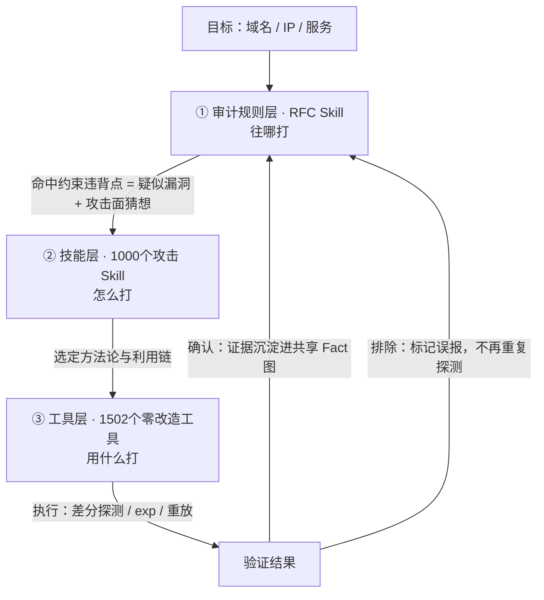

# RFC 审计规则 Skill 层（rfc-audit-skills）

> v0.8 规划 ｜ 2026-11-09 ｜ Apache-2.0（与 attack_skills_for_agent 全库同口径）
>
> 定位一句话：**1000 个攻击 Skill 负责"怎么打"（exp 原语、工具调用、利用链），RFC Skill 负责"往哪打、什么算打中了"（这条实现是否违背了协议设计、违背点是否对应已知漏洞模式）。Agent 的工作流就是：RFC Skill 给出定向审计目标 → 攻击 Skill 执行验证 → 结果回流更新判定。**

## 为什么加这一层

方法论来自智能攻防技术分享会 HTTP/3 专场实证：**高质量漏洞模式 = 历史同类漏洞 + RFC 中 MUST / MUST NOT 强制约束**。该团队据此在 QUIC-Go 找到与已知 CVE 同模式的内存耗尽漏洞、从 RFC 9114 的 capsule 约束挖出某主流 HTTP/3 代理的请求走私漏洞。传统 fuzzing 的痛点（状态覆盖难、输入生成贵、海量输出靠人工）被"先锚定约束、再定向审计"绕过。

## 三层结构与本仓的位置

| 层 | 数量 | 回答的问题 | 类比 | 本仓位置 |
|---|---|---|---|---|
| 工具层（注册表 v0.7） | 1502 | 用什么程序执行 | 武器本体 | 各工具源仓库 |
| 技能层（Skills v1.8） | 1000 | 怎么打（方法论 + 命令 + Playbook） | 攻击说明书 | `tool-skills/` 及各开源 skill 目录 |
| **审计规则层（本目录，v0.8 新增）** | **一期约 165 / 终局 1000** | 往哪打、违背了什么协议设计、什么算验证成功 | 导航 + 判定规则 | `rfc-audit-skills/` |

## 工作流

## 建设优先级清单

完整数据见 [priority_list.csv](priority_list.csv)。优先级判据：① 历史 CVE 密度 ② 实现集中度（差分可行性）③ 与现有 1000 Skill 的互补性 ④ 赛事与业务热点。

- **P0 试点**：HTTP/3 + QUIC + QPACK（约 25 个）、HTTP/2 + HPACK（约 20 个）
- **P1**：TLS 1.3（约 20）、Kerberos/AD 协议族（约 18）、OAuth2/OIDC/JWT（约 15）
- **P2**：WebSocket（约 12）、SSH（约 15）、DNS（约 15）、SMTP/IMAP/POP3（约 15）
- **P3**：SIP/RTP（约 10），按需启动

## 数量预估（双口径）

| 口径 | 数量 | 说明 |
|---|---|---|
| 一期（v0.8） | 约 165 个 | 10 个核心协议族，每 2–3 条关联 MUST/MUST NOT 聚为 1 个 Skill，先验证收益 |
| 终局目标 | 1000 个 | 80–120 个攻击面相关协议族铺满（IETF RFC + W3C + 厂商协议文档 + 历史 CVE 模式库），与技能层形成"双千"结构 |

抽取口径：不编码 RFC 全文，只抽 MUST / MUST NOT / SHOULD NOT 强制条款，按功能模块聚类（解析 / 流管理 / 错误处理 / Security Considerations 优先）。

## 单条 Skill 形态

模板见 [SKILL_TEMPLATE.md](SKILL_TEMPLATE.md)。每条含六个固定字段：约束条款原文（RFC 号 + 章节）/ 违规判定条件 / 攻击面猜想 / 关联历史 CVE / 差分验证方法 / 对接的攻击 Skill。单条体量小、可检索、可被 Router 层按「协议审计」类目调度。

## 建设节奏与验收

1. **第 1 步（2 周）**：HTTP/3 试点约 25 个 Skill 定稿入库
2. **第 2 步（2 周）**：对 ≥2 个开源实现（quic-go / ngtcp2 / aioquic 任选）跑差分审计，产出 ≥1 个疑似漏洞或违规点，验证收益
3. **第 3 步（4 周）**：按 P0 → P1 → P2 铺量，路由层同步新增「协议审计」类目
4. **第 4 步**：挂入 range 评测端到端验证，对比"有 / 无审计规则层"的打点效率

## 试点交付进度

HTTP/3 试点 25 个已全部交付（5 批 × 5 个，分支 rfc-audit-skills）；HTTP/2 + HPACK 第二条 P0 线已启动（目标约 20 个，第 1 批 5 个已交付，目录 `http2/`）：

| 批次 | 数量 | 覆盖 |
|---|---|---|
| H3 第 1 批 | 5 | H3 消息层基础约束（CL/DATA 一致性、QPACK 解码限长、伪头校验、SETTINGS 时序、GOAWAY 排水） |
| H3 第 2 批 | 5 | H3 压缩/扩展层（QPACK 动态表容量、Capsule、优先级、Server-Push 拒绝、版本协商） |
| H3 第 3 批 | 5 | QUIC 传输核心（流控记账、CID 生命周期、HANDSHAKE_DONE、路径验证反放大、无状态重置令牌） |
| H3 第 4 批 | 5 | QUIC 传输深化（ACK 范围/乐观确认、传输参数、Retry 完整性、NEW_TOKEN 重放、trailer 帧序列） |
| H3 第 5 批 | 5 | 迁移与关闭态（迁移拥塞窗/反放大、closing/draining 帧义务、流重置成本对称/H3 Rapid Reset、0-RTT 反重放、GREASE 容忍双向精确性） |
| H2 第 1 批 | 5 | H2 消息层与 HPACK 核心（CONTINUATION 限长执行 CVE-2024-27316、CL/DATA 降级走私 CVE-2021-21295、SETTINGS 洪泛 CVE-2020-11080、Rapid Reset 原版 CVE-2023-44487、HPACK 动态表容量时序 #1660） |

登记：多维表格「RFC审计规则清单（主表 · 随批次追加）」30 条在册；Router C51 按六子组（H3 消息层 7 / H3 压缩层 2 / H3 扩展层 2 / QUIC 传输层 14 / H2 消息层 4 / H2 压缩层 1）两级路由。

## License

Apache-2.0，与 attack_skills_for_agent 全库同口径。约束条款原文引用遵循 RFC 版权规则（IETF Trust License，允许合理引用与演绎）；历史 CVE 模式描述为事实性内容，与 NVD 公开信息对齐。
