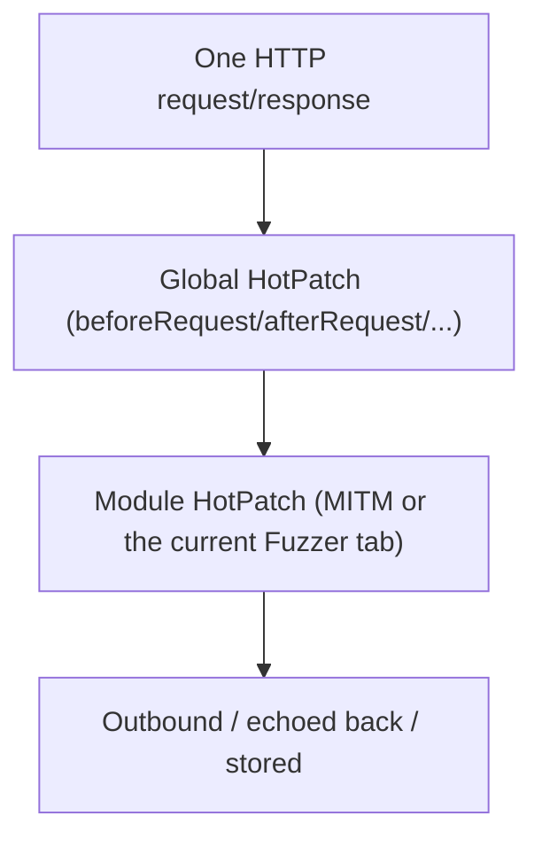
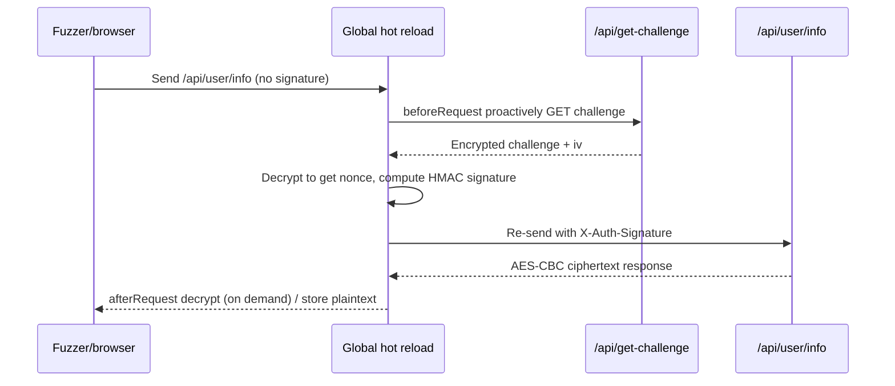

# SKILL: Yakit Global Hot Reload (Global Hot Patch)

> AI LOAD INSTRUCTION: This is the "global tier" of the three-tier hot reload system. Global hot reload is the system-wide hook shared by MITM and Web Fuzzer; the execution order is `global HotPatch -> module HotPatch`, and only one can be enabled at a time. It is best suited to "protocol normalization" — define site-wide encryption/decryption/signing/dyeing in one place and it automatically applies to MITM and every Fuzzer tab. Read the global vs module comparison first, then look at the examples under `examples/`, which are named after each Hook.

## 0. Related Routes

- Master entry point and three-tier architecture: yak
- Module-level MITM hot reload: [mitm-hotpatch](../mitm-hotpatch/SKILL.md)
- Module-level Web Fuzzer hot reload: [webfuzzer-hotpatch](../webfuzzer-hotpatch/SKILL.md)

## 1. Global vs Module

| Dimension | Global hot reload | Module (MITM / Fuzzer) hot reload |
|---|---|---|
| Entry point | Configuration management -> global template | MITM configuration / Fuzzer Hot Patch window |
| Scope | All MITM/Fuzzer traffic system-wide | Only the current MITM task or Fuzzer tab |
| Execution order | Runs **before** the module hooks | Runs after the global hooks |
| How many can be enabled | Only one at a time | Independent per MITM/tab |
| Best suited for | Protocol normalization, unified signing, site-wide dyeing, guardrails for dangerous operations | Specialized handling for a single task/endpoint |



## 2. Available Hooks (The Same Set as MITM, Global Runs First)

Global hot reload and MITM share the **same `MixPluginCaller` execution pipeline and Hook set** (backend `mitm_global_hotpatch_pipeline.go`: at each hook point `globalCaller` runs first, then `moduleCaller`). Therefore the 12 Hooks documented in [mitm-hotpatch](../mitm-hotpatch/SKILL.md) are **all available at the global tier with exactly the same signatures**; the only differences are that the global tier runs before the module tier and takes effect across MITM + Fuzzer.

yakit's default global template already uses `hijackHTTPRequest` + `beforeRequest` + `hijackSaveHTTPFlow` to stamp `X-Yakit-Global-HotPatch` on the whole site.

## 3. Index of All Hook Examples (examples/, one function per example)

**Every** Hook in the table has its own global-style example plus a YAK_MAIN self-test, and there are additionally 2 advanced multi-Hook examples that reproduce real published articles.

| Hook | Global example scenario | File |
|---|---|---|
| `hijackHTTPRequest` | Stamp a global marker on all outbound requests | [examples/hijack-request.yak](examples/hijack-request.yak) |
| `hijackHTTPResponse` | Stamp a global marker on all responses | [examples/hijack-response.yak](examples/hijack-response.yak) |
| `hijackHTTPResponseEx` | Conditionally rewrite the response using the request context | [examples/hijack-response-ex.yak](examples/hijack-response-ex.yak) |
| `beforeRequest` | Automatic injection of the default Authorization Bearer | [examples/before-request.yak](examples/before-request.yak) |
| `afterRequest` | Site-wide unified response audit marker | [examples/after-request.yak](examples/after-request.yak) |
| `mirrorHTTPFlow` | Site-wide traffic audit counters | [examples/mirror-http-flow.yak](examples/mirror-http-flow.yak) |
| `mirrorFilteredHTTPFlow` | Focused audit of site-wide filtered traffic | [examples/mirror-filtered-http-flow.yak](examples/mirror-filtered-http-flow.yak) |
| `mirrorNewWebsite` | Site-wide asset inventory | [examples/mirror-new-website.yak](examples/mirror-new-website.yak) |
| `mirrorNewWebsitePath` | Site-wide path inventory | [examples/mirror-new-website-path.yak](examples/mirror-new-website-path.yak) |
| `mirrorNewWebsitePathParams` | Site-wide list of fuzzable endpoints | [examples/mirror-new-website-path-params.yak](examples/mirror-new-website-path-params.yak) |
| `hijackSaveHTTPFlow` | Site-wide dyeing by status code + tagging | [examples/hijack-save-http-flow.yak](examples/hijack-save-http-flow.yak) |
| `mockHTTPRequest` | Global kill-switch blocking blacklisted domains | [examples/mock-http-request.yak](examples/mock-http-request.yak) |

Advanced (real article reproductions, multi-Hook combinations):

| Scenario | Hook combination | File |
|---|---|---|
| Site-wide SM4-CBC transparent encryption/decryption + storing plaintext | `beforeRequest` + `afterRequest` + `hijackSaveHTTPFlow` | [examples/advanced-sm4-transparent.yak](examples/advanced-sm4-transparent.yak) |
| Dynamic challenge + HMAC signature injection + response decryption | `beforeRequest` + `afterRequest` + `hijackSaveHTTPFlow` | [examples/advanced-challenge-sign.yak](examples/advanced-challenge-sign.yak) |

### Focus: The Dynamic Challenge Chain from Article 009

`examples/advanced-challenge-sign.yak` fully reproduces the scenario from public article 009; the self-test asserts offline using the **real captured packet data** given in the article:

1. `beforeRequest`: when `/api/user/info` is matched, proactively `GET /api/get-challenge`, decrypt to obtain the nonce, compute the HMAC signature and write it into `X-Auth-Signature`.
2. `afterRequest`: when the request carries `X-Yak-Force-Plaintext: 1`, decrypt the AES-CBC response into plaintext (avoiding unconditional rewriting that would break the browser frontend decryption).
3. `hijackSaveHTTPFlow`: MITM leaves the live traffic untouched and only rewrites the stored response into plaintext for easier analysis.



## 4. Standard Pattern: Hook Function + YAK_MAIN Self-Test

Exactly the same as MITM/Fuzzer — register the hook, then guard it with `if YAK_MAIN { runSelfTest() }`.

- `yak xxx.yak`: `YAK_MAIN = true`, run the self-test.
- yakit global hot reload window: `YAK_MAIN = false`, register the hook only.

> For online hooks (for example `fetchChallengeSignature` in the challenge chain needs `poc.HTTP` to send a side request), the self-test should verify only the **pure functions** it depends on (signature computation, response decryption), so that the self-test does not depend on a real lab range.

> Concurrency and global variables (important): global hot reload has a wider reach and higher concurrency. Put only **read-only constants** at the top level (keys/IVs/rules, assigned once at load time and never changed), and **never write to shared mutable globals inside the hook**, otherwise concurrent writes across requests cause a data race and crash. For cross-request aggregation use `sync.Map`/`sync.NewMutex()` or `db.*`/`risk.*`. See [webfuzzer-hotpatch section 6](../webfuzzer-hotpatch/SKILL.md) for details.

## 5. Verification

```bash
cd /Users/v1ll4n/Projects/yaklang
go run common/yak/cmd/yak.go skills/global-hotpatch/examples/advanced-challenge-sign.yak

# Same execution path as the Yakit gRPC (global pipeline order: beforeRequest -> hijack -> afterRequest):
go build -o /tmp/yak ./common/yak/cmd/yak.go
printf 'GET / HTTP/1.1\r\nHost: t.example.com\r\n\r\n' > /tmp/req.txt
printf 'HTTP/1.1 500 Internal Server Error\r\nContent-Length: 4\r\n\r\nboom' > /tmp/rsp.txt
/tmp/yak hotpatch-global --script skills/global-hotpatch/examples/hijack-save-http-flow.yak --request /tmp/req.txt --response /tmp/rsp.txt
```

Each example should: finish within 10 seconds, pass all asserts, log only in English, and print `... self test passed`.

## References

- yak-project-public 009 (2026-03-18) Frontend Encryption Is Too Stubborn to Test? Global Hot Reload Takes Over the Signature Flow Automatically
- yak-project-public 030 (2025-10-24) Yakit hot reload practical techniques
- yak-project-public 085 (2024-11-27) Configuring plugin environment variables globally
- Engine implementation: `common/yakgrpc/grpc_global_hotpatch_test.go`

> 📎 **Reference Document Notice**: this skill is adapted from an upstream open-source repository; the following reference document is **not distributed with this library**: `SKILL.md`. The key points of the related topics are retained in the corresponding descriptions in this document; if you need the expanded content, grep the library using keywords from the body text or search on your own.
