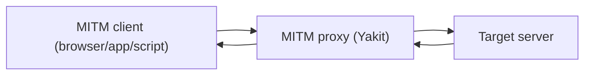

# SKILL: Yakit MITM Hot Reload (Hot Patch)

> AI LOAD INSTRUCTION: This is the "module-level MITM" topic of Yaklang's three-tier hot reload system. MITM hot reload lets security testers dynamically take over each processing stage of HTTP traffic with Yaklang code without interrupting the proxy service. Read the Hook trigger-timing table and the forward/drop semantics on this page first, then look at the examples under `examples/`, which are named after each Hook and can each be self-tested directly with `yak <file>`.

## 0. Related Routes

- Master entry point and three-tier architecture: yak
- Web Fuzzer hot reload (per-tab request encryption/decryption and retries): [webfuzzer-hotpatch](../webfuzzer-hotpatch/SKILL.md)
- Global hot reload (system-wide hooks that run before module execution): [global-hotpatch](../global-hotpatch/SKILL.md)

## 1. The Three Basic Roles

Before understanding the Hooks, understand the three parties in a MITM:



- Browser: the side that directs traffic to Yakit (browser, mobile app, automation script).
- MITM proxy (Yakit): receives requests, may modify or drop them, then forwards them to the target; after getting the response it may modify it again and write it back to the client. All Hooks are attached inside the proxy.
- Target server: the real backend.

## 2. The Three Hook Categories and Their Trigger Timing

Yakit MITM splits Hooks into three categories: request/response hijacking (synchronous and serial, can modify and drop), mirroring (observation and analysis only), and packet storage handling.

| Hook | Trigger timing | Can rewrite | How it submits |
|---|---|---|---|
| `hijackHTTPRequest(isHttps, url, req, forward, drop)` | After the browser issues the request, before it goes to the target (the main request interception point) | Yes | `forward(req)` / `drop()` |
| `hijackHTTPResponse(isHttps, url, rsp, forward, drop)` | After the target response arrives, before it is written back to the client | Yes | `forward(rsp)` / `drop()` |
| `hijackHTTPResponseEx(isHttps, url, req, rsp, forward, drop)` | Same as above, but also receives req (recommended) | Yes | `forward(rsp)` / `drop()` |
| `beforeRequest(isHttps, oreq, req)` | The last moment before the request goes out (after hijackHTTPRequest) | Yes (submitted via the return value) | `return req` |
| `afterRequest(isHttps, oreq, req, orsp, rsp)` | The last moment before the response is written back (after hijack response) | Yes (submitted via the return value) | `return rsp` |
| `mirrorHTTPFlow(isHttps, url, req, rsp, body)` | After every request/response completes (all traffic) | No, observation only | None |
| `mirrorFilteredHTTPFlow(isHttps, url, req, rsp, body)` | Only traffic that passes the filter rules | No, observation only | None |
| `mirrorNewWebsite(isHttps, url, req, rsp, body)` | When a new domain is discovered (once per domain) | No, observation only | None |
| `mirrorNewWebsitePath(isHttps, url, req, rsp, body)` | When a new path is discovered (once per domain + path) | No, observation only | None |
| `mirrorNewWebsitePathParams(isHttps, url, req, rsp, body)` | When a new parameter combination is discovered (deduplicated by structure) | No, observation only | None |
| `hijackSaveHTTPFlow(flow, modify, drop)` | The last step before being stored in History | Yes (modifies the flow) | `modify(flow)` / `drop()` |
| `mockHTTPRequest(isHttps, url, req, mockResponse)` | Before the request goes out, can be replaced by a local response | Yes (replaces the response) | `mockResponse(rspStr)` |

### forward / drop Semantics (The Core of Hijack-Style Hooks)

- `forward(req|rsp)`: pass the (possibly rewritten) packet through. A hijack-style hook **must** call forward or drop for every packet, otherwise the request hangs.
- `drop()`: discard the packet.
- When the target is not matched you must still call `forward(original packet)`, so the remaining traffic and subsequent plugins keep working.

### The Peculiarities of beforeRequest / afterRequest

Here "Request" follows the Burp/Zap convention and refers to the whole round trip of "browser sends request -> proxy forwards -> proxy gets response".

- `beforeRequest`: the last chance to modify the request before it goes out, submitted through the **return value**; the modification is invisible in the user's hijack interface.
- `afterRequest`: the last chance to modify the response before it is written back, also submitted through the return value.

## 3. mirror Deduplication Semantics (Important)

When the following sequence is visited:

```text
http://a:8080/abc/        http://a:8080/abc/12      http://a:8080/abc/13
http://a:8080/abc/14      http://a:8080/abc/14?x=1  http://b:8080/abc/14
```

- `mirrorNewWebsite`: triggers 2 times (once each for the domains `a:8080` and `b:8080`).
- `mirrorNewWebsitePath`: triggers 5 times (4 distinct paths under `a:8080` + `b:8080/abc/14`; `/abc/14?x=1` with a query is still `/abc/14`, so it is not a duplicate).
- `mirrorNewWebsitePathParams`: deduplicates by the **structure** of the query parameters (the same parameter names with different values do not trigger again).

## 4. Index of All Hook Examples (examples/, one function per example)

**Every** Hook in the table has its own example plus a YAK_MAIN self-test, so `yak <file>` proves it by itself; the evidence is in `scripts/validate-skills.yak`.

| Hook | Example scenario | File |
|---|---|---|
| `hijackHTTPRequest` | Rewrite a JSON business field (amount) before it goes out | [examples/hijack-request.yak](examples/hijack-request.yak) |
| `hijackHTTPResponse` | Add missing security headers based on the response alone + strip the version banner | [examples/hijack-response.yak](examples/hijack-response.yak) |
| `hijackHTTPResponseEx` | Remove blocking JavaScript (alert/redirect) while keeping the debug page | [examples/hijack-response-ex.yak](examples/hijack-response-ex.yak) |
| `beforeRequest` | Inject a Trace header as the last step before going out (submitted via the return value) | [examples/before-request.yak](examples/before-request.yak) |
| `afterRequest` | Mark the response for debugging before write-back (submitted via the return value) | [examples/after-request.yak](examples/after-request.yak) |
| `mirrorHTTPFlow` | Passively scan all traffic for sensitive information leakage | [examples/mirror-http-flow.yak](examples/mirror-http-flow.yak) |
| `mirrorFilteredHTTPFlow` | Count filtered traffic by content type | [examples/mirror-filtered-http-flow.yak](examples/mirror-filtered-http-flow.yak) |
| `mirrorNewWebsite` | New domain discovery -> asset inventory | [examples/mirror-new-website.yak](examples/mirror-new-website.yak) |
| `mirrorNewWebsitePath` | New path discovery and deduplicated collection | [examples/mirror-new-website-path.yak](examples/mirror-new-website-path.yak) |
| `mirrorNewWebsitePathParams` | New parameter combination discovery -> fuzz target selection | [examples/mirror-new-website-path-params.yak](examples/mirror-new-website-path-params.yak) |
| `hijackSaveHTTPFlow` | Tag with sensitive keywords + dye the flow before storing it | [examples/hijack-save-http-flow.yak](examples/hijack-save-http-flow.yak) |
| `mockHTTPRequest` | Mock guardrail for dangerous operations (DELETE/PUT) | [examples/mock-http-request.yak](examples/mock-http-request.yak) |

## 5. Standard Pattern: Hook Function + YAK_MAIN Self-Test

All MITM hot reload scripts share the same structure — register the hook as a function variable, then guard the local self-test with `if YAK_MAIN { runSelfTest() }`:

```yak
hijackHTTPRequest = func(isHttps, url, req, forward, drop) {
    // ... rewrite it when the target is matched, forward the original packet otherwise
    forward(req)
}

func runSelfTest() {
    // use custom forward/drop callbacks to capture the result and assert
}

if YAK_MAIN {
    runSelfTest()
}
```

`YAK_MAIN` is a global boolean injected by the engine:

- Running `yak xxx.yak` from the command line: `YAK_MAIN = true`, run `runSelfTest()` for a mock self-test.
- Loading in the yakit MITM hot reload window: `YAK_MAIN = false`, the self-test block does not run, only the hook is registered.

Therefore it is completely safe to paste the full script, including the self-test block, back into yakit.

> Concurrency and global variables (important, avoids crashes): MITM calls the same hook **concurrently**. Treat top-level global variables as **read-only constants** (assign keys/IVs/rule tables once at load time and never modify them inside the hook). **Do not write to shared mutable globals inside the hook** (a bare `append` to a global slice or assigning to a global map triggers a data race and panics outright). When you must aggregate across requests, use `sync.Map`/`sync.NewMutex()` or store them in `db.*`/`risk.*`; the global accumulation in this library's `mirror-*` examples is only demo code for **single-threaded command-line self-testing**. See [webfuzzer-hotpatch section 6](../webfuzzer-hotpatch/SKILL.md) for details.

### How to Mock Each Hook in a Self-Test

| Hook | Self-test verification |
|---|---|
| `hijackHTTPRequest` / `hijackHTTPResponseEx` | Custom `forward`/`drop` callbacks, assert the captured packet content |
| `mirror*` | Call the hook directly, assert that the outer state (set/slice/dye field) changed |
| `hijackSaveHTTPFlow` | Use a `map` to simulate `*HTTPFlow`, stub `AddTag`/color methods, verify that `modify(flow)` was called |
| `mockHTTPRequest` | Custom `mockResponse` callback, verify the target is triggered and non-targets are not |

## 6. Quick Reference of Common APIs

| Purpose | API |
|---|---|
| Get the request/response body | `poc.GetHTTPPacketBody(packet)` |
| Replace the body | `poc.ReplaceHTTPPacketBody(packet, newBody)` |
| Get/replace a header | `poc.GetHTTPPacketHeader(packet, key)` / `poc.ReplaceHTTPPacketHeader(packet, key, val)` |
| Get the request method | `poc.GetHTTPRequestMethod(req)` |
| Get the response status code | `poc.GetStatusCodeFromResponse(rsp)` |
| Raw flow text | `codec.StrconvUnquote(flow.Request)~` / `codec.StrconvQuote(str)` |
| Send a request proactively | `poc.HTTP(raw, poc.https(b), poc.timeout(5), poc.save(false))~` |

## 7. Verification

```bash
cd /Users/v1ll4n/Projects/yaklang
go run common/yak/cmd/yak.go skills/mitm-hotpatch/examples/hijack-request.yak
# Or with the installed engine: yak skills/mitm-hotpatch/examples/hijack-request.yak

# Validate on a real request using the same execution path as the Yakit gRPC:
go build -o /tmp/yak ./common/yak/cmd/yak.go
printf 'POST /api/order/create HTTP/1.1\r\nHost: shop.example.com\r\nContent-Type: application/json\r\n\r\n{"amount":100}' > /tmp/req.txt
/tmp/yak hotpatch-mitm --script skills/mitm-hotpatch/examples/hijack-request.yak --request /tmp/req.txt
```

Each example should: finish within 10 seconds, pass all asserts, log only in English, and finally print `... self test passed`.

## References

- yak-project-public 031 (2025-10-17) Full breakdown of the MITM hot reload flow: one article dissecting the four practical Hook scenarios
- yak-project-public 030 (2025-10-24) Yakit hot reload practical techniques
- yak-project-public 024 (2025-12-05) Mock: reshaping pollution-free client testing
- Engine implementation: `common/yak/hook_mixed_plugin_caller.go`

> 📎 **Reference Document Notice**: this skill is adapted from an upstream open-source repository; the following reference document is **not distributed with this library**: `SKILL.md`. The key points of the related topics are retained in the corresponding descriptions in this document; if you need the expanded content, grep the library using keywords from the body text or search on your own.
