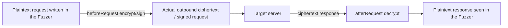
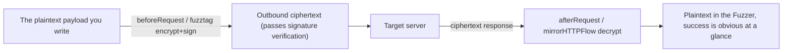

# SKILL: Yakit Web Fuzzer Hot Reload (Hot Patch)

> AI LOAD INSTRUCTION: This is the "module-level Web Fuzzer" topic of the three-tier hot reload system. Web Fuzzer hot reload acts on the request-sending flow of a single Fuzzer tab; its most typical uses are "internal network encryption evasion" (request encryption, response decryption, signature injection) and "automated decisions" (retry, business-failure determination). Read the Hook signatures and return-value semantics first, then look at the examples under `examples/`, which are named after each Hook and can each be self-tested with `yak <file>`. For "frontend encryption HACK variants / showing plaintext to the user", jump straight to the combo recipes in section 5 (`examples/combo-*.yak`); before writing any hot reload, be sure to read section 6 "Concurrency and Global Variables" to avoid race-condition crashes.

## 0. Related Routes

- Master entry point and three-tier architecture: yak
- MITM hot reload (proxy-side hijack/mirror/store): [mitm-hotpatch](../mitm-hotpatch/SKILL.md)
- Global hot reload (runs before module execution, shared by MITM/Fuzzer): [global-hotpatch](../global-hotpatch/SKILL.md)

## 1. Hook Signatures and Return-Value Semantics

Web Fuzzer hot reload hooks differ from MITM hooks in one key way: hijack-style hooks submit their modifications through the **return value** (not forward/drop).

| Hook | Signature | Purpose | How it submits |
|---|---|---|---|
| `beforeRequest` | `(https, originReq, req) -> req` | Rewrite the request before it goes out (encrypt/sign/add headers) | `return` the new request |
| `afterRequest` | `(https, originReq, req, originRsp, rsp) -> rsp` | Rewrite the response before it is echoed back (decrypt/format) | `return` the new response |
| `retryHandler` | `(https, retryCount, req, rsp, retry)` | Decide the next step when a retry is triggered | `retry([newReq])` |
| `customFailureChecker` | `(https, req, rsp, fail)` | Custom "failure" determination | `fail("reason")` |
| `mirrorHTTPFlow` | `(req, rsp, params) -> params` | Extract parameters for `{{params(name)}}` | `return` a map |
| `mockHTTPRequest` | `(https, url, req, mockResponse)` | Use a local response when offline or no service is available | `mockResponse(rspStr)` |

> Note: Web Fuzzer's `mirrorHTTPFlow(req, rsp, params)` and MITM's `mirrorHTTPFlow(isHttps, url, req, rsp, body)` have **different signatures**; do not mix them up.

## 2. Core Scenario 1: Internal Network Encryption Evasion

Modern web applications often encrypt or sign requests/responses. Moving the encryption/decryption and signing logic into a hot reload lets you fuzz **plaintext** directly in the Fuzzer, with requests encrypted automatically on send and responses decrypted automatically on echo.



| Scenario | Hook | Example |
|---|---|---|
| timestamp+nonce+HMAC signature injection | `beforeRequest` | [examples/before-request.yak](examples/before-request.yak) |
| AES-CBC response decryption (plaintext in the Fuzzer) | `afterRequest` | [examples/after-request.yak](examples/after-request.yak) |

Chinese national cryptography (SM4-CBC / SM2 / SM3) works the same way: just replace `codec.AESCBC*` with `codec.SM4*` / `codec.Sm3`.

## 3. Core Scenario 2: Automated Decisions (Retry / Failure Determination)

The two functions introduced in article 043 turn "manually analyzing the response and then deciding what to do" into automated, code-driven logic:

| Scenario | Hook | Example |
|---|---|---|
| 405→POST / 429 backoff / 401 give up / 5xx retry | `retryHandler` | [examples/retry-handler.yak](examples/retry-handler.yak) |
| 200 OK but the body contains failure keywords → treat as failure | `customFailureChecker` | [examples/custom-failure-checker.yak](examples/custom-failure-checker.yak) |
| Use a local response for integration testing while the target is not up yet | `mockHTTPRequest` | [examples/mock-http-request.yak](examples/mock-http-request.yak) |

- `retryHandler` must be used together with yakit Fuzzer's retry configuration (enable retries + specify failure status codes).
- `customFailureChecker` solves the hard filtering problem of brute force where "the protocol layer returns 200 but the business layer failed".
- `mockHTTPRequest` lets payload rendering, retries, and failure determination work end-to-end in integration testing even without a real service.

## 4. Core Scenario 3: fuzztag and Correlated Testing

| Scenario | Mechanism | Example |
|---|---|---|
| Dynamically compute a hash payload | `{{yak(hash|md5,admin)}}` | [examples/fuzztag-handle.yak](examples/fuzztag-handle.yak) |
| Extract token/csrf across multiple requests | `mirrorHTTPFlow` returns a map → `{{params(name)}}` | [examples/mirror-http-flow.yak](examples/mirror-http-flow.yak) |

A plain function defined inside a hot reload, such as `f = func(param){ return [...] }`, can be called as a `{{yak(f|param)}}` tag; each element of the returned array is one payload.

## 5. Frontend Encryption Evasion Combo Recipes (Show Plaintext to the User)

A single hook solves a single problem, but a real "frontend encryption HACK" usually needs **multiple hooks combined**: encryption/signing on the request side and decryption on the response side, so you always face **plaintext** in the Fuzzer. This is the core trick for bypassing frontend encryption to run brute force or tests.



| Combo Recipe | Hooks Involved | Frontend Protection Defeated | Example |
|---|---|---|---|
| AES-CBC write plaintext / read plaintext round trip | `beforeRequest` + `afterRequest` | CryptoJS AES-CBC static key | [examples/combo-aescbc-plaintext-roundtrip.yak](examples/combo-aescbc-plaintext-roundtrip.yak) |
| Encryption + HMAC signature verification (dual protection) | `beforeRequest` + `afterRequest` | AES encryption layered with anti-tamper signatures | [examples/combo-sign-and-encrypt.yak](examples/combo-sign-and-encrypt.yak) |
| RSA-OAEP + AES-GCM hybrid encryption | `{{yak(...)}}` fuzztag + `mirrorHTTPFlow` | Dynamic public key + asymmetric wrapping of the symmetric key | [examples/combo-rsa-aesgcm-hybrid.yak](examples/combo-rsa-aesgcm-hybrid.yak) |

Key points:
- On the **request side**, use `beforeRequest` (encrypt/sign the whole packet) or the `{{yak(fn|...)}}` fuzztag (encrypt only one field).
- On the **response side**, use `afterRequest` (rewrite the response directly into a plaintext echo) or `mirrorHTTPFlow` (extract the decrypted result into a variable, combine it with the `{{params(name)}}` sequence, and spot success at a glance in the result table).
- For dynamic keys/public keys, use a **Web Fuzzer sequence**: Step0 fetches the key → the data extractor stores `publicKey`/`privateKey` → Step1 references it via `{{params(publicKey)}}` (see the header comment of the hybrid encryption example).
- Common algorithm APIs: `codec.AESCBCEncryptWithPKCS7Padding` / `codec.AESGCMEncryptWithNonceSize12` / `codec.RSAEncryptWithOAEP` / `codec.HmacSha256`; for Chinese national cryptography use `codec.Sm4*` / `codec.SM2*`.

> Why "plaintext password transmission" is worth testing: see article 183 — frontend encryption only raises the bar, the password itself can still be recovered from the traffic; once the channel is decrypted into plaintext, ordinary injection, brute force, and logic testing all become usable again.

## 6. Concurrency and Global Variables: Prefer "Read-Only Constants", Otherwise It Crashes

**This is the crash pitfall most likely to bite you in hot reloads.** MITM / Web Fuzzer calls the same hook **concurrently** for multiple requests (the same script instance). If your hook **reads and writes the same mutable top-level global variable** (for example `append`ing to a global slice, assigning to a global map, or incrementing a global counter), multiple goroutines writing at the same time trigger a **data race**: at best the results get scrambled, at worst it panics and crashes outright.

Rules:

- **Put configuration / keys / IVs / rule tables at the top level, but treat them as "read-only constants"**: assign them once at load time and **never modify them inside the hook**. This usage is inherently concurrency-safe (all encryption combo examples in this section are written this way).
- **Do not write to shared mutable globals inside the hook**. When you need to accumulate or collect data:
  - Prefer keeping the state in a **function local** or passing it out through the return value (`mirrorHTTPFlow` returns a map, `afterRequest` returns the packet).
  - If you really must aggregate across requests, use a concurrency-safe container/lock: `sync.Map`, `sync.NewMutex()` with locking, or yakit's `db.*` / `risk.*` storage, instead of a bare `append` to a global slice.

```yak
// Counter-example (crashes under concurrency): multiple requests append to the same global slice simultaneously
RESULTS = []
mirrorHTTPFlow = func(req, rsp, params) { RESULTS = append(RESULTS, req); return {} }  // Dangerous!

// Good example: only read-only constants at the top level, results are carried out through the return value
AES_KEY = codec.DecodeHex("3132...")~   // Read-only constant, never modified again
afterRequest = func(https, oreq, req, orsp, rsp) {
    return poc.ReplaceHTTPPacketBody(rsp, decrypt(AES_KEY, poc.GetHTTPPacketBody(rsp)))
}
```

> The `mirror-*` single-hook examples in this library use global slice/map accumulation to make the self-test assertable — that is demo code for **single-threaded command-line self-testing**; in a real concurrent MITM/Fuzzer, follow the rules above and switch to read-only constants + return values/locking.

## 7. Standard Pattern: Hook Function + YAK_MAIN Self-Test

```yak
beforeRequest = func(https, originReq, req) {
    // Rewrite req
    return req
}

func runSelfTest() {
    // Build a mock request, call the hook, assert the return value
}

if YAK_MAIN {
    runSelfTest()
}
```

`YAK_MAIN` distinguishes the runtime environment:

- `yak xxx.yak` command line: `YAK_MAIN = true`, run the self-test.
- yakit Fuzzer hot reload window: `YAK_MAIN = false`, register the hook only.

### How to Mock Each Hook in a Self-Test

| Hook | Self-test verification |
|---|---|
| `beforeRequest` / `afterRequest` | Build mock requests/responses and assert the returned packet content (you can decrypt the encrypted result again to verify the round trip) |
| `retryHandler` | Provide a custom `retry` callback (`func(args...)`) and assert the call count and the new request content |
| `customFailureChecker` | Provide a custom `fail` callback and assert whether it was flagged as failed |
| `mirrorHTTPFlow` | Call it directly and assert the extracted fields in the returned map |
| `mockHTTPRequest` | Provide a custom `mockResponse` callback and verify that the target is triggered |

## 8. Quick Reference: Common codec / poc APIs

| Purpose | API |
|---|---|
| AES-CBC encrypt/decrypt | `codec.AESCBCEncrypt(key, data, iv)~` / `codec.AESCBCDecrypt(key, cipher, iv)~` |
| Base64 encode/decode | `codec.EncodeBase64(b)` / `codec.DecodeBase64(s)~` |
| HMAC-SHA256 (returns bytes) | `codec.EncodeToHex(codec.HmacSha256(key, data))` |
| Hash | `codec.Md5(s)` / `codec.Sha256(s)` / `codec.EncodeToHex(codec.Sm3(s))` |
| Status code | `poc.GetStatusCodeFromResponse(rsp)` |
| Change method | `poc.ReplaceHTTPPacketMethod(req, "POST")` |
| Change body / header | `poc.ReplaceHTTPPacketBody` / `poc.ReplaceHTTPPacketHeader` |
| Get request method/path | `poc.GetHTTPRequestMethod(req)` / `poc.GetHTTPRequestPath(req)` |

## 9. Verification

```bash
cd /Users/v1ll4n/Projects/yaklang
go run common/yak/cmd/yak.go skills/webfuzzer-hotpatch/examples/before-request.yak

# Same execution path as the Yakit gRPC (MutateHookCaller); verify the {{yak(...)}} fuzztag:
go build -o /tmp/yak ./common/yak/cmd/yak.go
printf 'GET / HTTP/1.1\r\nHost: t.example.com\r\n\r\n' > /tmp/req.txt
/tmp/yak hotpatch-webfuzzer --script skills/webfuzzer-hotpatch/examples/fuzztag-handle.yak \
    --request /tmp/req.txt --fuzztag '{{yak(hash|md5,hello)}}'
```

Each example should: finish within 10 seconds, pass all asserts, log only in English, and print `... self test passed`.

## References

- yak-project-public 043 (2025-07-25) The new Web Fuzzer hot reload functions — retry control and error handling
- yak-project-public 183 (2023-09-14) Advanced Penetration Testing Techniques: Analyzing Signature Verification and Frontend Encryption (1) (HMAC signature verification + AES-CBC, source of the combo recipes)
- yak-project-public 177 (2023-10-11) Advanced Penetration Testing Techniques (2): Defeating Frontend Dynamic Keys and Asymmetric Encryption Protections (RSA-OAEP + AES-GCM hybrid, source of the hybrid encryption combo)
- yak-project-public 084 (2024-12-05) Advanced Penetration Testing Techniques (3): Testing Vulnerabilities That Are Encrypted by the Frontend
- yak-project-public 270 (2022-07-28) Frontend AES-ECB Encryption: Hands-on Web Security Testing
- yak-project-public 282/285 (2022-05) Yakit Web Fuzzer Ultimate Capability Enhancement: Hot Reload Fuzz
- yak-project-public 167 (2023-11-17) Web Fuzzer Advanced
- Engine implementation: `common/yak/script_engine_for_fuzz.go`

> 📎 **Reference Document Notice**: this skill is adapted from an upstream open-source repository; the following reference document is **not distributed with this library**: `SKILL.md`. The key points of the related topics are retained in the corresponding descriptions in this document; if you need the expanded content, grep the library using keywords from the body text or search on your own.
