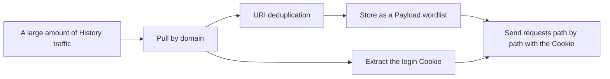

# SKILL: Yakit Historical Data Extraction and Wordlist-Driven Scanning

> AI LOAD INSTRUCTION: This skill addresses a specific pain point — "a pile of traffic for one domain has piled up in History, and you want to pull out all the unique paths, grab the login Cookie, and then continue scanning/fuzzing". Two end-to-end runnable examples are given: pulling traffic by domain with URI deduplication and Cookie extraction, and wiring the deduplicated paths into a Payload wordlist and sending real authenticated requests to scan them.
> Both examples pass the `yak <file>` self-test, and the scanning example spins up a local real target server and sends real HTTP requests as evidence.

## 0. Related Routes

- Master entry point: yak
- Database APIs (KV / Payload / queries): yaklang-database
- To collect traffic during the MITM stage instead of querying the database afterwards: [mitm-hotpatch](../mitm-hotpatch/SKILL.md)
- Cross-reference in the training material: `yaklang-ai-training-materials/library-usage/db/db-practice.yak`

## 1. Breaking Down the Pain Point

A common workflow gets stuck on "moving data around":



Doing this by hand is painful: paths repeat, query strings get in the way of deduplication, Cookies are scattered across different requests, and you forget the authenticated session while scanning.
This skill scripts every step with `db` + `poc`.

## 2. Pull History by domain + URI Deduplication + Cookie Extraction

Core data shapes (verify first, do not guess):

| Source | Shape |
| --- | --- |
| `db.QueryHTTPFlowsByKeyword(domain)` | Returns a `*HTTPFlow` iterator (channel) |
| `flow.Url` | Full URL string |
| `flow.Request` | The string after `codec.StrconvQuote`, needs `codec.StrconvUnquote` to get the original bytes |
| Login Cookie | `poc.GetHTTPPacketHeader(req, "Cookie")` |

```yak
collectFromHistory = func(domain) {
    pairs = []
    for flow in db.QueryHTTPFlowsByKeyword(domain) {
        req = codec.StrconvUnquote(flow.Request)~
        pairs = append(pairs, {"url": flow.Url, "req": []byte(req)})
    }
    return analyzePairs(pairs)   // normalize + deduplicate + collect cookies
}
```

Use "host+path with the scheme and query stripped" as the deduplication key, so that `?page=1` / `?page=2` are not treated as two different entries.

Full example: [examples/collect-domain-urls.yak](examples/collect-domain-urls.yak)

## 3. Wiring Deduplicated Paths into a Payload Wordlist + Authenticated Scanning

Store the paths as a Yakit Payload wordlist (persistent, reusable in the Web Fuzzer / scanners), then send requests one by one with the Cookie and distinguish live from non-existent by the status code:

```yak
db.SavePayload(group, dedupPaths(paths))~        // Store after deduplication
for path in db.YieldPayload(group) {             // Iterate the wordlist and scan each entry
    raw = sprintf("GET %s HTTP/1.1\r\nHost: %s\r\nCookie: %s\r\nConnection: close\r\n\r\n", path, hostport, cookie)
    rsp, _ = poc.HTTP(raw, poc.timeout(5), poc.save(false))~
    code = poc.GetStatusCodeFromResponse(rsp)    // 200 live / 404 not found
}
```

Full example: [examples/path-scan-with-payload.yak](examples/path-scan-with-payload.yak)
(The self-test starts a real target server on a random local port, actually sends HTTP requests, and verifies the status code and Cookie pass-through)

## 4. Pitfalls (Verify Before Writing Code)

- `flow.Request` / `flow.Response` are strings after strconv-quoting, so using them directly as raw text brings in escape sequences; always use `codec.StrconvUnquote(...)~`.
- `db.YieldPayload(group)` yields the payload content string directly, not an object with a `.Content` field; use `p` directly.
- `db.SavePayload` writes to the persistent profile store; in scripts use a group with a unique prefix and clean up with `defer db.DeletePayloadByGroup(group)` to avoid pollution.
- Deduplication must strip the query first, otherwise different pages of the same endpoint are treated as different URIs.
- Request-sending scans must use `poc.timeout(...)` + `poc.save(false)` (do not write to the database during self-tests or batch runs), to avoid hanging and polluting History.

## 5. How to Verify the Extraction/Scanning Script You Wrote

- Run `yak your-script.yak` directly and let the `YAK_MAIN` self-test block exercise the logic with synthetic data + a local target server.
- To verify real History retrieval, first collect a few flows with [mitm-hotpatch](../mitm-hotpatch/SKILL.md) and then run it.
- See yaklang-toolchain for the toolchain and command-line verification methods.

> 📎 **Reference Document Notice**: this skill is adapted from an upstream open-source repository; the following reference document is **not distributed with this library**: `SKILL.md`. The key points of the related topics are retained in the corresponding descriptions in this document; if you need the expanded content, grep the library using keywords from the body text or search on your own.
